<p align="center">
  <picture>
    <source srcset="assets/brand/banner.svg" type="image/svg+xml">
    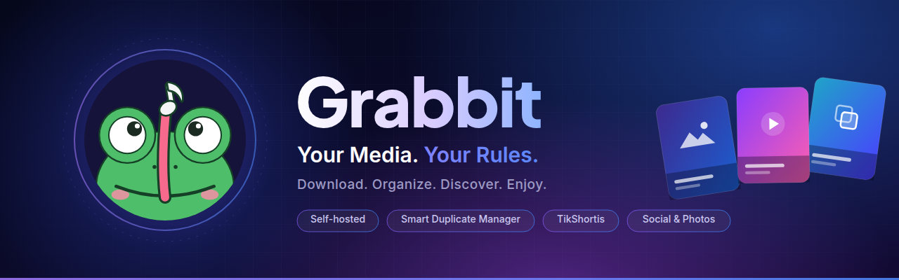
  </picture>
</p>

<p align="center">
  
  
  
  
  <br>
  
  
  
  
  
</p>

<p align="center">
  <b>Grabbit is a self-hosted media hub.</b> It downloads from the sites you use,
  files everything into your own libraries, finds the duplicates and lets you
  browse it all from one fast, phone-friendly interface.
</p>

<p align="center">
  <a href="#docker-quick-start">Quick start</a> ·
  <a href="#feature-overview">Features</a> ·
  <a href="#smart-duplicate-manager-20">Duplicate Manager</a> ·
  <a href="documentation/architecture.md">Architecture</a> ·
  <a href="documentation/configuration.md">Configuration</a>
</p>

<p align="center">
  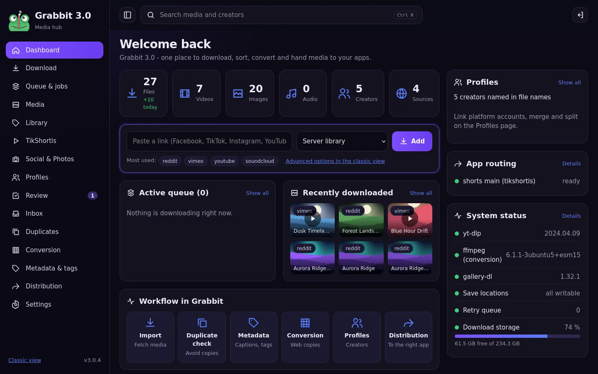
</p>

---

## Introduction

Grabbit started as a downloader: paste a link, get the file. Version 3 turns it
into a **media hub that you run on your own hardware**. A Raspberry Pi is
enough.

- **Download** from everything yt-dlp supports, plus dedicated extractors for
  sites it handles poorly. Long downloads run as background jobs.
- **Organize** files into libraries for video, photos, music and audiobooks,
  with creator profiles, tags and a manual audience classification.
- **Discover** your media in native feeds: short videos through TikShortis and
  photo posts through Social & Photos.
- **Keep it clean** with the Smart Duplicate Manager. It finds exact copies,
  similar photos and re-encoded videos. By default nothing is removed until you
  say so.

Grabbit runs on its own. TikShortis and Elitogram are optional separate
applications, and this README marks clearly which features need them.

> [!NOTE]
> Grabbit is a general-purpose tool. It hosts no content and points to
> nothing. You are responsible for what you download and for whether you have
> the right to keep it. See the [Disclaimer](#disclaimer).

## Table of contents

- [Feature overview](#feature-overview)
- [Screenshot showcase](#screenshot-showcase)
- [Smart Download Engine](#smart-download-engine)
- [Smart Duplicate Manager 2.0](#smart-duplicate-manager-20)
  - [AI Photo Engine and DINOv2](#ai-photo-engine-and-dinov2)
  - [Video Fingerprint Engine](#video-fingerprint-engine)
  - [Smart Trash and safe duplicate management](#smart-trash-and-safe-duplicate-management)
- [Native TikShortis](#native-tikshortis)
- [Social & Photos](#social--photos)
- [Creator management](#creator-management)
- [Metadata and hashtags](#metadata-and-hashtags)
- [Architecture](#architecture)
- [Requirements](#requirements)
- [Docker Quick Start](#docker-quick-start)
- [Configuration reference](#configuration-reference)
- [Storage and volumes](#storage-and-volumes)
- [Security and privacy](#security-and-privacy)
- [Backup and recovery](#backup-and-recovery)
- [Development and testing](#development-and-testing)
- [Roadmap](#roadmap)
- [Contributing](#contributing)
- [License and acknowledgements](#license-and-acknowledgements)
- [Credits](#credits)

## Feature overview

| | Feature | Status in 3.0.4 |
|:-:|---|---|
| ⬇ | **Smart Download Engine**: site extractors with a yt-dlp fallback, background jobs, retries, playlist watching | Built in |
| ◫ | **Smart Duplicate Manager 2.0**: exact, perceptual, AI and video matching with Smart Trash | Built in |
| ◉ | **AI Photo Engine**: DINOv2 image embeddings, run locally | Built in, optional (model download on request) |
| ▶ | **Native TikShortis**: vertical video feed, explore, playlists, profiles | Needs the separate [TikShortis](https://github.com/tjelite1986/tikshortis) backend |
| ▦ | **Social & Photos**: photo feed, explore grid, collections, post editing | Needs the separate [Elitogram](https://github.com/tjelite1986/elitogram) backend |
| ☺ | **Creator profiles**: one profile, many accounts, merge and split | Built in |
| # | **Metadata & tags**: source captions, hashtags, edits with a change log | Built in |
| ♫ | **Music and audiobook libraries**: music tagging through iTunes and Deezer lookups | Built in |
| ◈ | **Per-app access (GDA)**: tokens for co-hosted apps, scoped by audience | Built in |
| ◇ | Native Videos, Movies & music, Home | [Planned](#roadmap) |

## Screenshot showcase

All screenshots come from a demo instance of 3.0.4 with generated sample
media and sandbox backends. No real libraries or accounts were used.

<table>
  <tr>
    <td width="50%">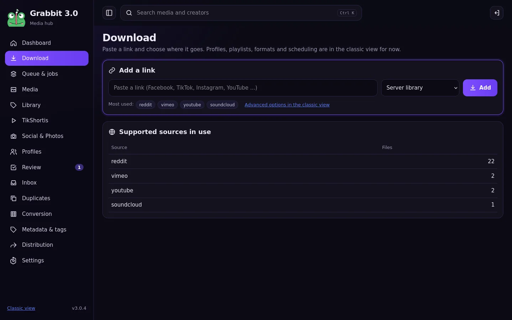<br><sub><b>Download</b>: paste a link and choose where it goes.</sub></td>
    <td width="50%">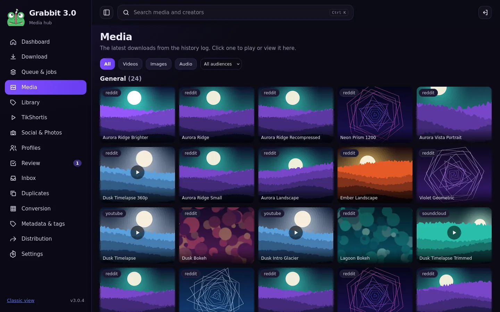<br><sub><b>Media</b>: everything you downloaded, by kind and audience.</sub></td>
  </tr>
  <tr>
    <td>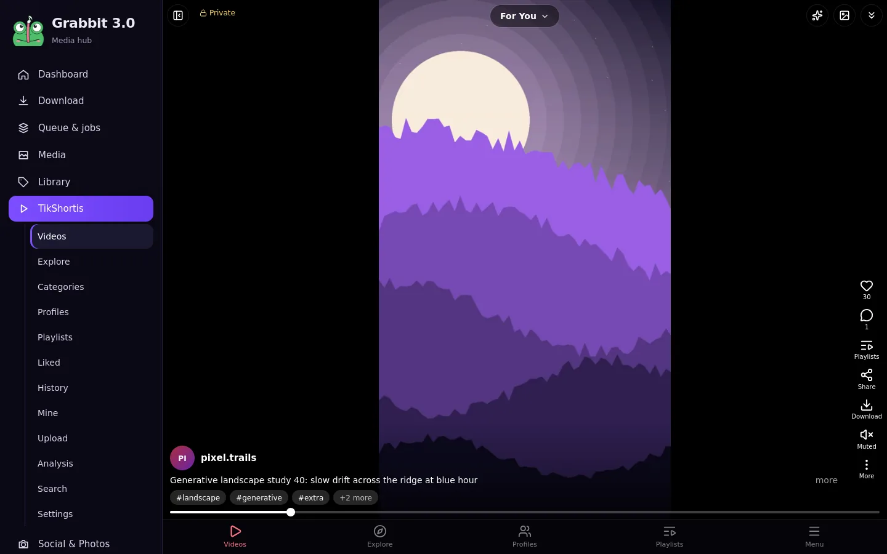<br><sub><b>TikShortis</b>: the short-video feed, native in the hub.</sub></td>
    <td>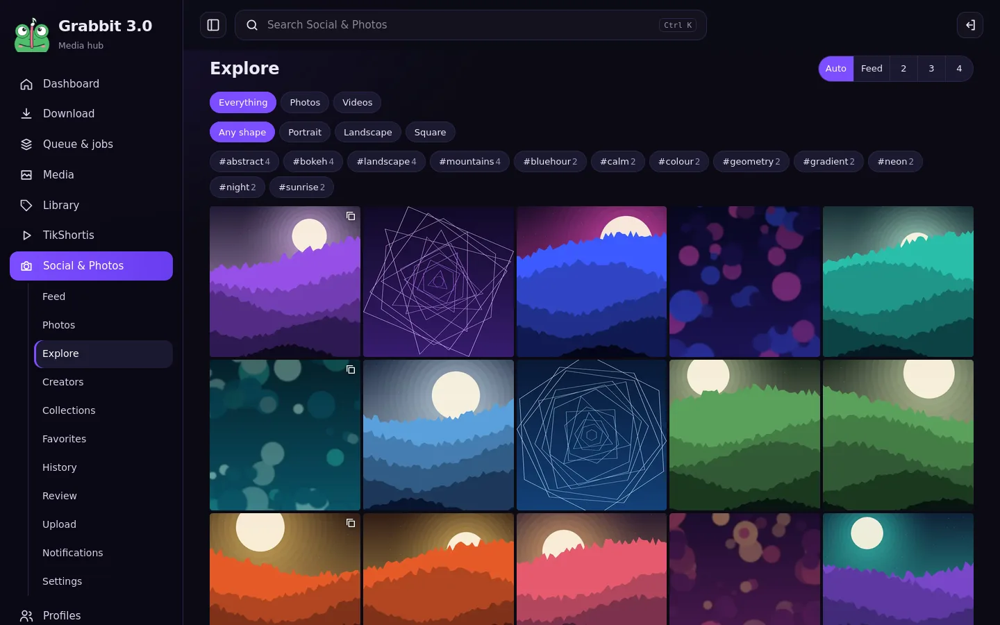<br><sub><b>Social & Photos</b>: the explore grid.</sub></td>
  </tr>
  <tr>
    <td>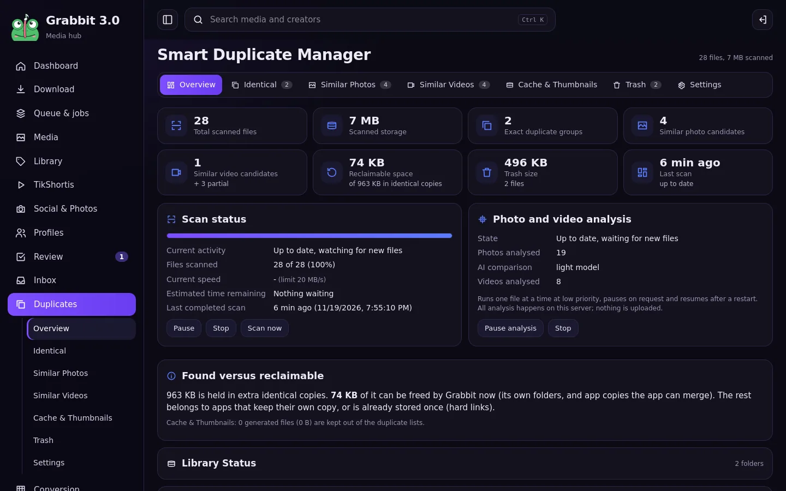<br><sub><b>Duplicate Manager</b>: what was found and what can be freed.</sub></td>
    <td>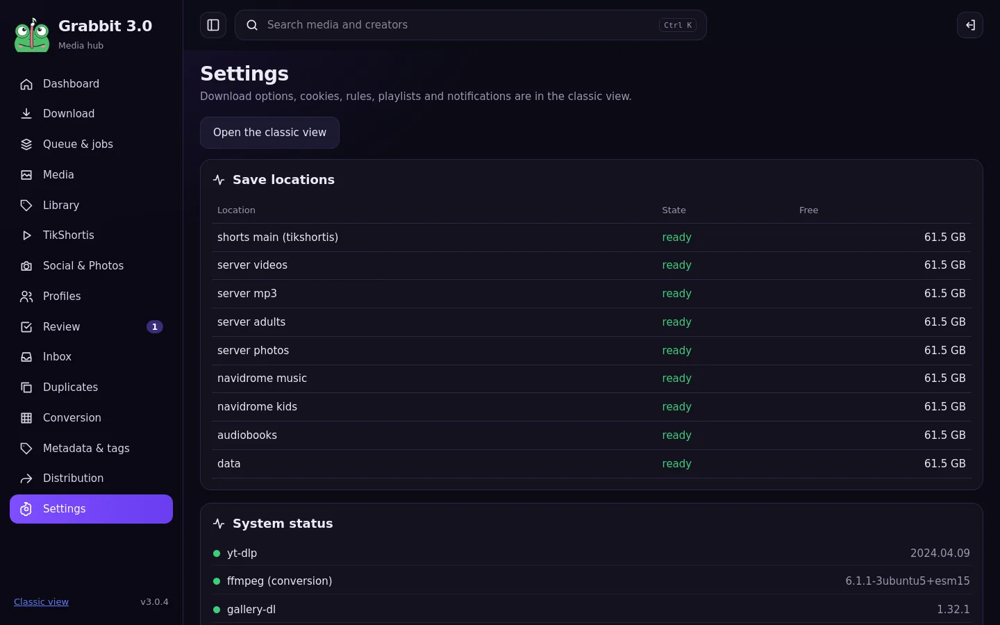<br><sub><b>Settings</b>: save locations and system status.</sub></td>
  </tr>
</table>

<p align="center">
  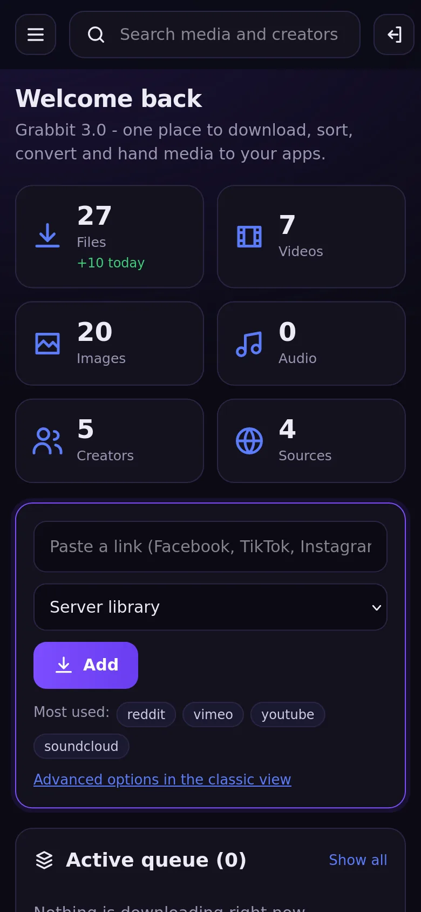
  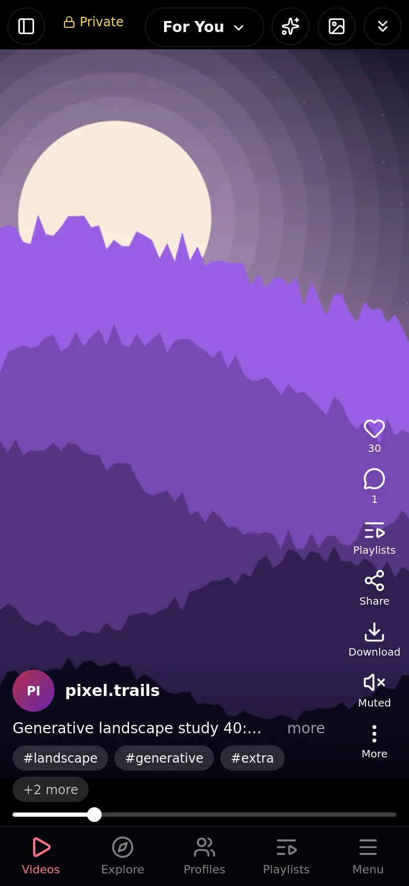
  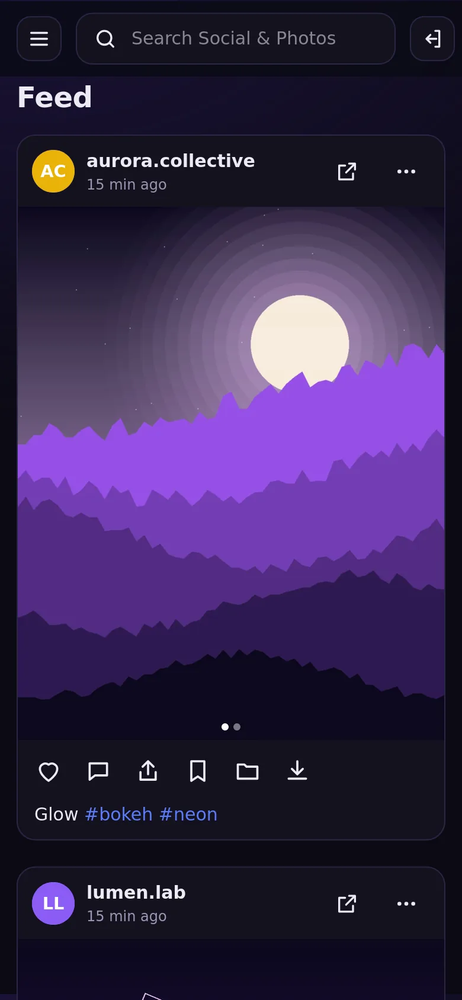
  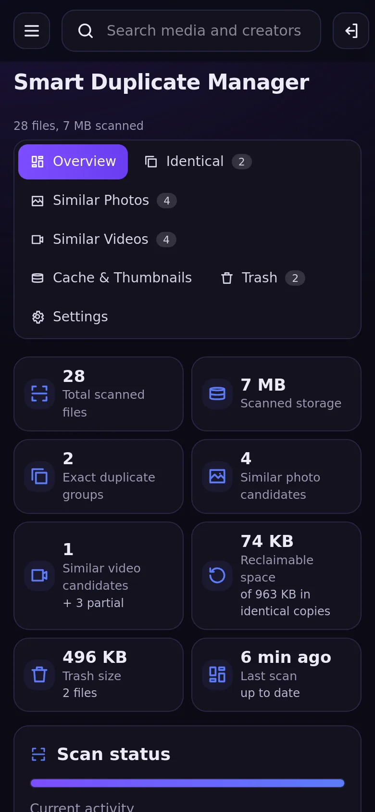
  <br><sub>The same hub on a phone: dashboard, TikShortis, Social & Photos and the Duplicate Manager.</sub>
</p>

<p align="center">
  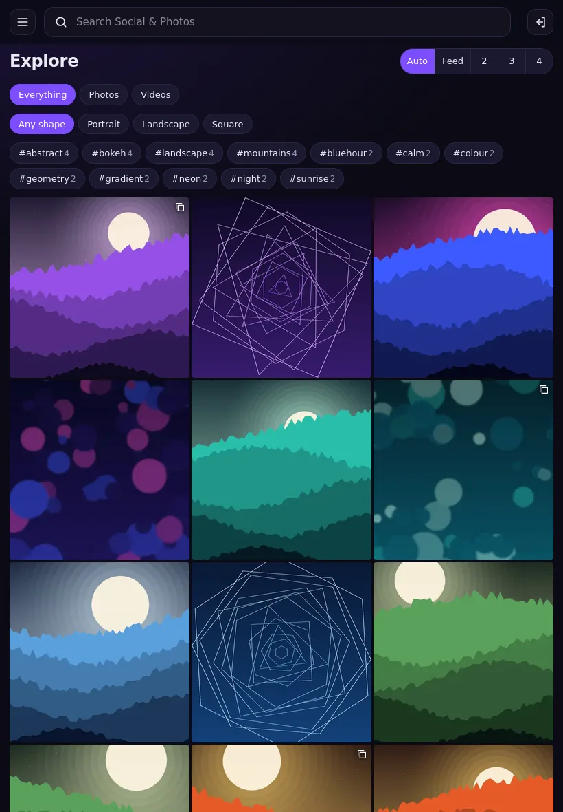
  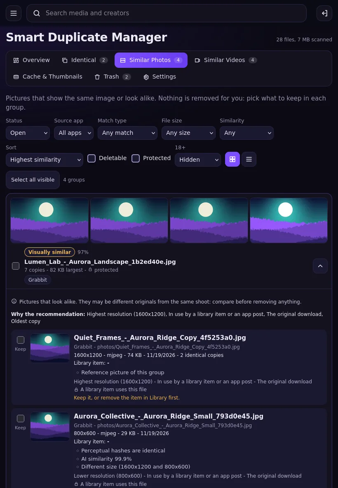
  <br><sub>On a tablet: the explore grid and similar photos.</sub>
</p>

## Smart Download Engine

- **Any link yt-dlp supports**, plus dedicated extractors in
  [`extractors/`](extractors) for sites that yt-dlp covers poorly. Image
  galleries go through gallery-dl.
- **Background jobs.** A download starts at once and reports progress over
  Server-Sent Events. Up to two run at a time (`MAX_ACTIVE_JOBS`) and the rest
  wait in the queue. Jobs survive a page reload.
- **Retries that make sense.** A job gets three attempts, with a short wait
  between them. If a video save to the server library or a shorts channel
  hits a temporary upstream error (404 while a CDN is still encoding, 403,
  429, 5xx), it is parked in a persistent retry queue with backoff. An entry
  is dropped after 12 attempts, or when an attempt fails after it has waited
  more than 72 hours. Permanent errors fail fast and are kept in the history.
- **Destinations.** Stream to your device, save to the server library, file
  into a music or audiobook library with tags, or hand the file to a co-hosted
  app. App destinations are opt-in: an unset folder means the destination does
  not exist.
- **Playlists and schedules.** Watch a playlist and new entries are fetched
  automatically. Schedule a start time, cut sections, split by chapters, or
  handle sponsor segments with SponsorBlock.
- **Already downloaded?** A registry keyed on the site's own media id marks
  what you already have, so playlists only offer what is new.

Playlists, formats, scheduling, cookies, rules and notifications are still set
up in the classic view (`/classic/`). The [user guide](documentation/user-guide.md)
explains every field.

## Smart Duplicate Manager 2.0

<p align="center">
  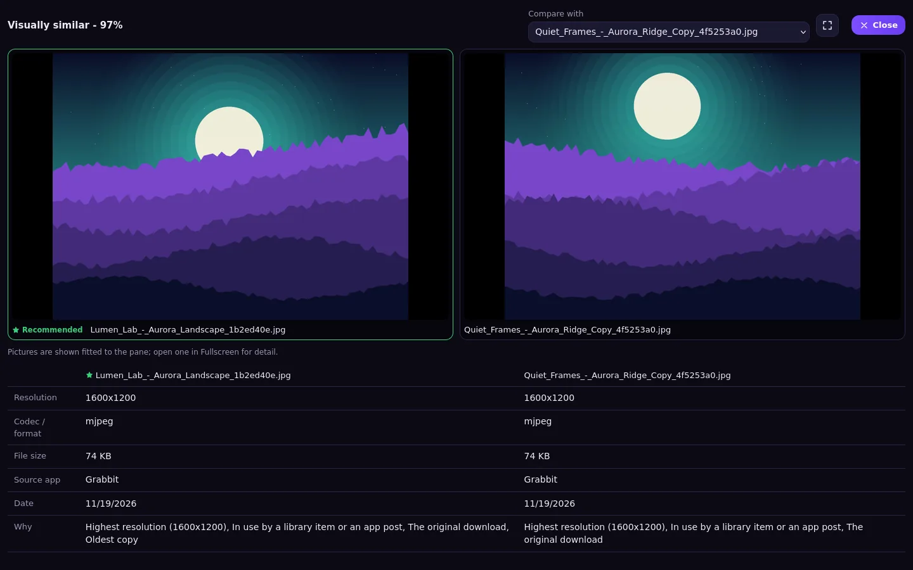
</p>

The Duplicate Manager scans your libraries in the background, groups copies
and shows them side by side. **With the default settings it never removes
anything on its own**: every action is yours, and every removal goes to a
trash you can restore from. Two things act automatically only when you switch
them on: duplicate prevention for exact copies (skip to trash, or link) and a
trash retention period.

| Engine | How it matches | Result |
|---|---|---|
| **Exact** | SHA-256 of the full file | *Identical*: same bytes |
| **Perceptual photo** | 64-bit pHash, also of the 90°, 180° and 270° rotations | *Near*: resized, recompressed or rotated |
| **AI photo** (optional) | DINOv2 embeddings, cosine similarity | *Similar*: same scene, other crop or edit |
| **Video fingerprint** | pHash of keyframes and fixed probe frames | *Re-encoded*, *similar* or *partial* (one clip inside another) |

<table>
  <tr>
    <td width="50%">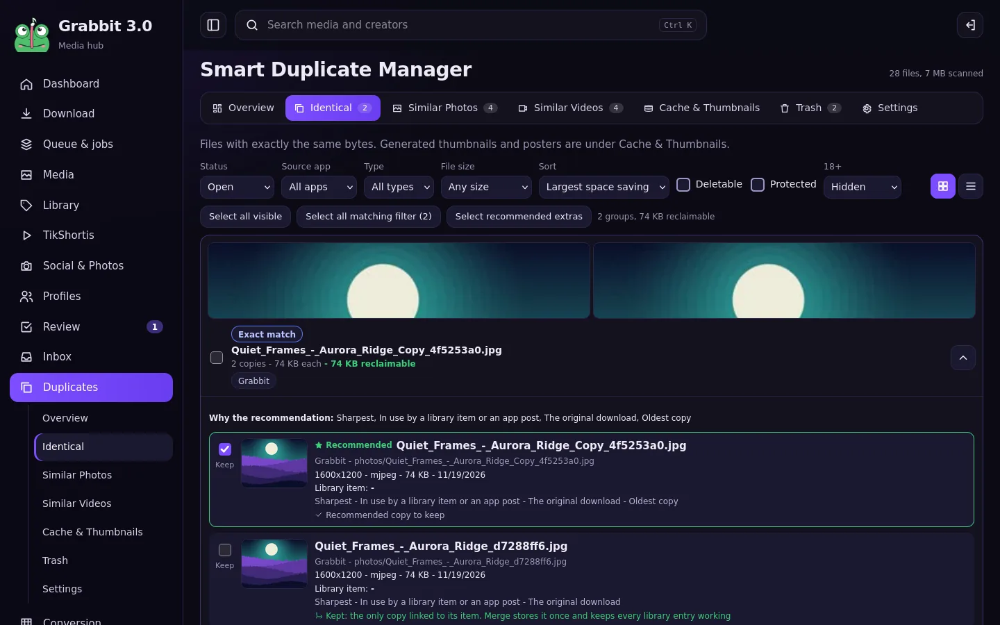<br><sub><b>Identical</b>: exact copies, with the space each group frees.</sub></td>
    <td width="50%">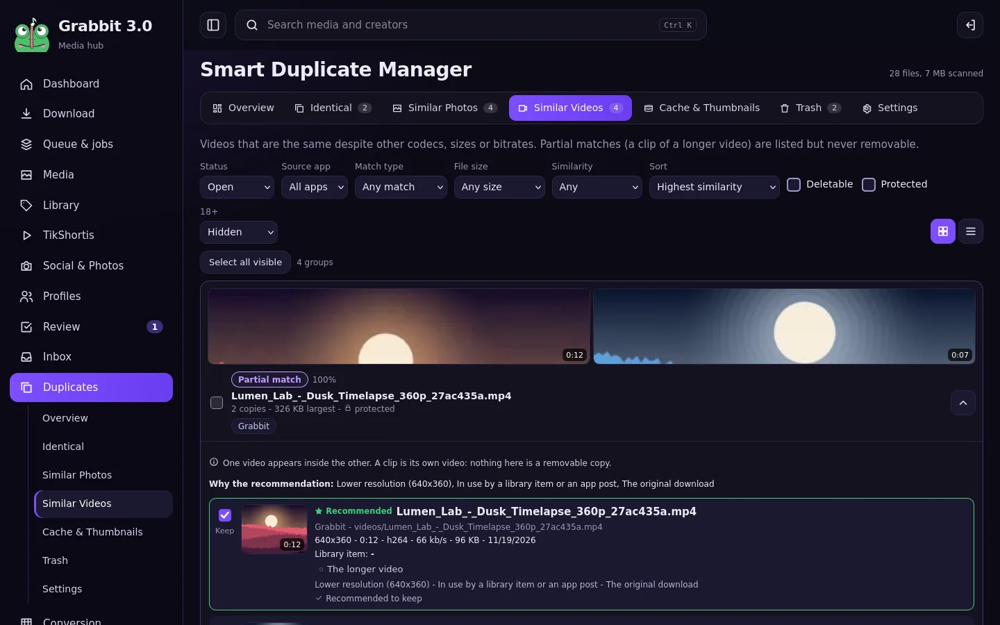<br><sub><b>Similar videos</b>: re-encodes and clips cut from a longer video.</sub></td>
  </tr>
  <tr>
    <td>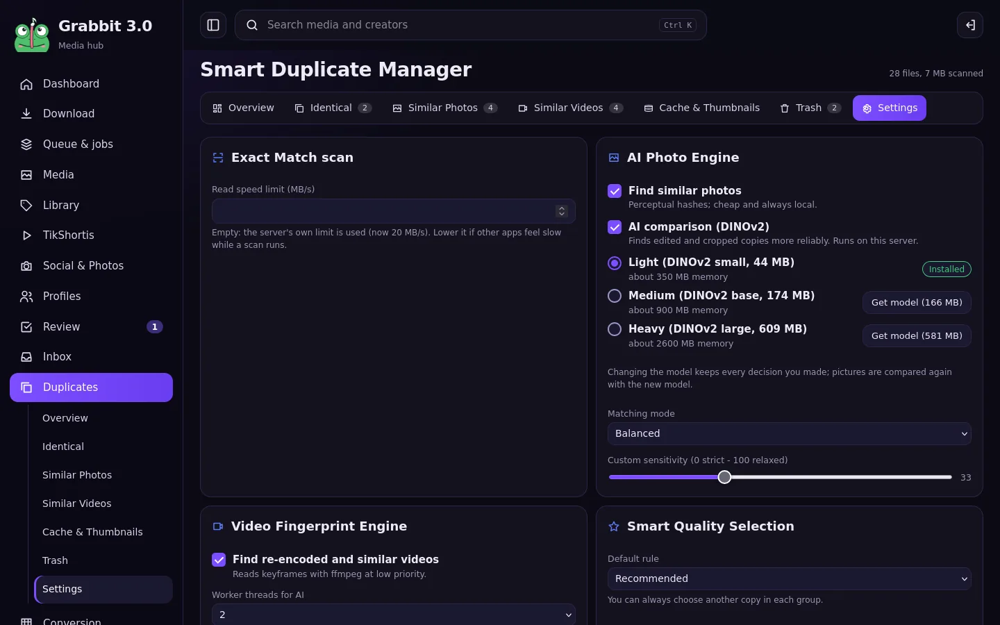<br><sub><b>Settings</b>: engines, AI model, keep rule and trash retention.</sub></td>
    <td>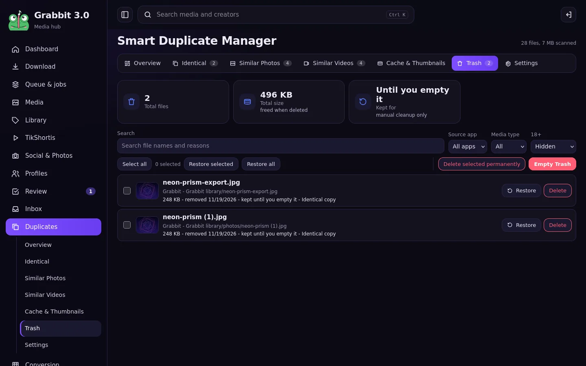<br><sub><b>Smart Trash</b>: restore, or delete for good when you choose.</sub></td>
  </tr>
</table>

**What it covers**

- **Scanning.** A read-only background scanner hashes every media file once.
  It never follows symlinks, reads at a limit you set (20 MB/s by default) and
  can be paused, resumed or stopped. Unchanged files are not read again.
- **Analysis.** Photo and video analysis run one file at a time. The ffmpeg
  and image tools it starts run at low CPU and I/O priority (`nice`/`ionice`)
  where available. Everything happens on your server.
- **Cross-app duplicates.** The scanner also reads the app folders you
  configure (for example TikShortis and Elitogram). Each app keeps its own copy
  and its own records. Where the app offers a dedupe operation, Grabbit asks
  the app to perform it rather than touching the app's files. A library that
  has no adapter is shown for information only.
- **Hard links.** Names that already share one file on disk are shown as
  *already stored once* and counted once. Identical copies inside Grabbit's
  own folders on the same disk can be merged into hard links, so every name
  keeps working.
- **Duplicate prevention.** When a download job saves files to the server,
  each saved file (up to 20 per job) is checked against the library. By
  default a match is flagged for review. You can
  instead choose to keep it, skip it (to the trash) or link it, and those
  choices apply only when both copies are in Grabbit's folders.
- **Cache & Thumbnails.** Generated files such as thumbnails are listed per
  app, with a dry run before any cleanup or rebuild.
- **18+ separation.** 18+ groups are hidden by default, and an 18+ copy is
  never merged into a general app.

> [!IMPORTANT]
> Similar photos and videos are **suggestions for manual review**. Nothing in
> a similar group is pre-selected, bulk actions skip them, and only exact
> groups can be merged. Check every AI or video match yourself before you act
> on it.

### AI Photo Engine and DINOv2

The AI engine compares photos by content: the same scene with a different
crop, edit or export. It is **off by default**. In **Duplicates → Settings**,
press **Get model** to download a model, then switch on **AI comparison
(DINOv2)**. Downloading alone does not turn it on.

- **Model:** DINOv2 small (*Light*, 44 MB), exported to ONNX by
  [photo-duplicate-finder-ai](https://github.com/nikweel/photo-duplicate-finder-ai).
  The download is checked against a pinned size and SHA-256. Medium and Heavy
  variants are listed in the settings, but they have no pinned checksum yet,
  so Grabbit refuses to download them.
- **Runtime:** `onnxruntime-node` is an optional dependency, and inference
  runs locally on the CPU. If the runtime is missing, the AI switch is greyed
  out and the other engines keep working.
- **Tuning:** strict, balanced or relaxed modes, or a custom sensitivity, and
  1 to 4 threads.
- **Safety net:** a low AI similarity vetoes a perceptual match unless the
  match came from a rotation, which keeps look-alike compositions apart.

### Video Fingerprint Engine

- ffmpeg decodes keyframes (up to 240) and eight probe frames at fixed points
  of the video, and each becomes a small perceptual hash. Flat frames, such as
  black fades, are ignored.
- **Same length:** a *re-encoded* match needs at least 80% matching frames,
  and a *similar* match at least 55%. Either way the matches must cover three
  of the four quarters of the video, so a shared intro alone never makes two
  videos match.
- **Different length:** a shorter clip is aligned against the longer video by
  voting on the time offset. It is labelled *partial* and is never offered for
  removal.

### Smart Trash and safe duplicate management

- Copies removed from Grabbit's own folders move to `DATA_DIR/dupe-trash`,
  outside every scanned folder. A copy inside TikShortis or Elitogram is
  removed by that app through its adapter, so restoring or purging it depends
  on that app.
- **Retention is manual by default** (never purged automatically). You can
  choose 7, 14, 30, 60 or 90 days, and shortening the retention asks for its
  own confirmation.
The guarantees below apply to entries held in Grabbit's own trash.

- **Restore** puts a file back at its original path, or next to it as
  `name (restored).ext` when that name is taken. A merged copy gets its
  original file back in place of the hard link.
- **Deleting permanently** is refused unless another copy with the same bytes
  is verified to remain. *Empty trash* only goes ahead when the count, size and
  fingerprint you confirmed still match.
- **Media references are preserved.** A file that is the only copy behind a
  library item is never removed. Merges keep every name working, and every
  operation is journaled.

> [!CAUTION]
> These safeguards reduce risk. They do not guarantee against data loss.
> Keep backups of your media, and review before you empty the trash. Known
> limits are listed in [Security and privacy](#security-and-privacy).

## Native TikShortis

<p align="center">
  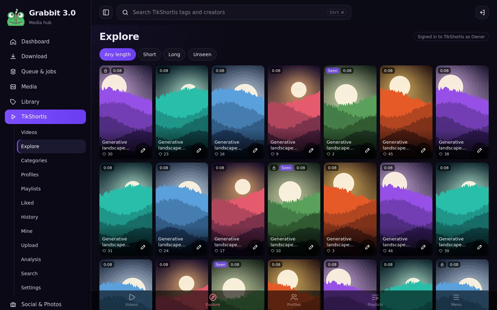
</p>

The hub has its own TikShortis pages: a vertical video feed with an immersive
player and keyboard navigation, Explore, categories, profiles, playlists,
liked videos, history, upload and settings.

- **What is native:** the interface (`public/hub/tik/`) and a gateway at
  `/api/tik` that forwards only an allowlist of methods and paths.
- **What needs the backend:** everything else. Clips, accounts, likes,
  comments and playlists live in the separate
  [TikShortis](https://github.com/tjelite1986/tikshortis) application. Grabbit
  keeps only your sealed TikShortis session.
- **Linking:** you sign in once with your TikShortis account. The TikShortis
  session is sealed (AES-256-GCM) in an HttpOnly cookie.
- **Not configured?** The menu entry is hidden and `/api/tik` is not mounted.
  If the backend is down, the page says so and offers *Try again*.

Set `TIKSHORTIS_MODE=native` and `TIKSHORTIS_API_URL`. An `embed` mode that
frames an existing TikShortis site is also available. See
[configuration](documentation/configuration.md#tikshortis).

## Social & Photos

<p align="center">
  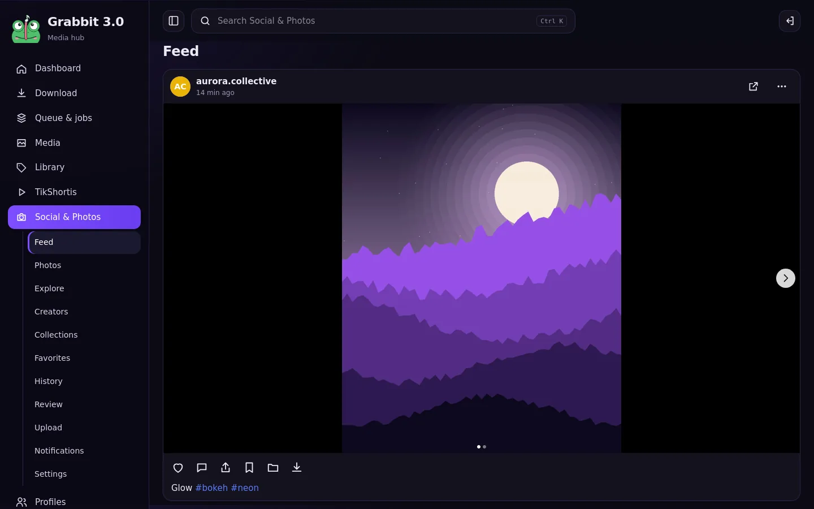
</p>

Social & Photos puts an Instagram-style photo experience into the hub: a feed,
Photos and Explore grids (Auto, Feed, or 2 to 4 columns), creators you follow,
collections and favorites, history, upload, notifications and a post viewer
with swipeable carousels. **Edit post** changes a post's creator, description
and tags.

- **Backend:** the separate [Elitogram](https://github.com/tjelite1986/elitogram)
  application keeps the database, accounts and media. You link your Elitogram
  account once.
- **No 18+ content.** Browsing uses the general lane, and a Review lane shows
  unclassified content so you can classify it. Answers in both lanes are
  checked again against Grabbit's own 18+ profiles, and adult records are
  dropped. 18+ content cannot be reached through Social & Photos.
- **Publishing:** with `POSTS_TO_EGRAM=1` and `EGRAM_IMPORT_DIR`, downloaded
  images are dropped into Elitogram's import folder.

Set `EGRAM_MODE=native` and `EGRAM_API_URL`. See
[configuration](documentation/configuration.md#social--photos-elitogram).

## Creator management

<p align="center">
  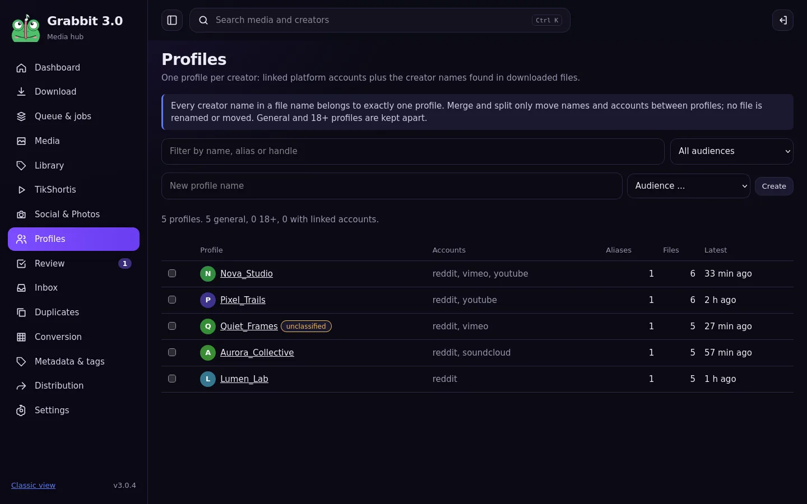
</p>

- **One profile, many accounts.** A creator profile holds several platform
  accounts and filename aliases. Merge and split profiles without losing an
  alias.
- **Manual classification.** The Review page classifies creators, groups and
  items as general or 18+, by hand only. Profiles created automatically stay
  unclassified until you decide.
- **Audience only tightens.** An 18+ profile or item never becomes general
  again, and general apps only receive items that were classified general.

## Metadata and hashtags

<p align="center">
  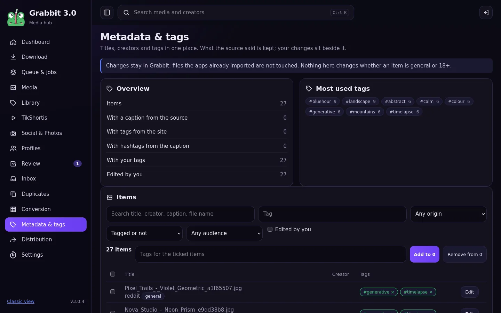
</p>

- **The source record is kept.** Each item keeps the title, creator, caption
  and raw record from the source, and they are never overwritten.
- **Your edits are separate.** Edited titles and creators are stored next to
  the source values. Clear an edit and the source value shows again. Every
  change is logged.
- **Tags with an origin.** Tags come from the site, from `#hashtags` in the
  caption, or from you, and the origin is kept. Nothing is guessed.
- **Bulk tools.** Search, filter, use the tag cloud, add or remove tags in
  bulk, and rename a creator everywhere.

## Architecture

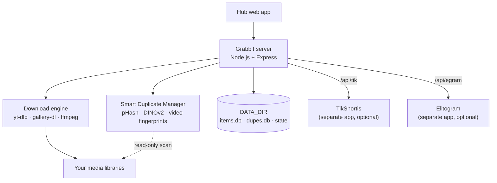

Grabbit is a single Node.js process with a vanilla-JavaScript interface.
Downloads and media tools run in child processes, AI inference runs inside
the server process, state lives in `DATA_DIR`, and TikShortis and
Elitogram stay separate applications with their own data. The
[architecture guide](documentation/architecture.md) has the full component
diagram, the outbound network traffic and the planned modules.

## Requirements

| | Docker (recommended) | Without Docker |
|---|---|---|
| Runtime | Docker Engine with the Compose plugin | Node.js 22 or newer (the image's version; yt-dlp's YouTube solver needs it as its JavaScript runtime) |
| Tools | Included in the image | Python 3 with a virtual environment holding `yt-dlp[default]` (set to use Node as its JS runtime), and ffmpeg. Optional in the same environment: mutagen (music and audiobook tags), gallery-dl and curl_cffi |
| Platform | linux/arm64 (Raspberry Pi 4/5) or linux/amd64 | The same, or macOS for development |
| Memory | About 350 MB extra while the Light AI model runs | Same |

There is **no published container image**. You build the image from this
repository, which takes a few minutes the first time.

## Docker Quick Start

```bash
git clone https://github.com/tjelite1986/grabbit.git
cd grabbit
mkdir -p data downloads/{videos,mp3,photos}
printf 'GRABBIT_PASSWORD=%s\n' "$(openssl rand -hex 16)" > .env
cat .env   # this is your login password
```

Save this as `docker-compose.yml`:

```yaml
services:
  grabbit:
    build: .
    container_name: grabbit
    restart: unless-stopped
    ports:
      - "127.0.0.1:3000:3000"
    environment:
      - GRABBIT_PASSWORD=${GRABBIT_PASSWORD}
      - TZ=Etc/UTC
    volumes:
      - ./data:/data
      - ./downloads:/downloads
```

```bash
docker compose up -d --build
```

Open `http://localhost:3000` on the same machine and sign in with the password
from `.env`. The login cookie is marked `Secure`, so browsers accept it only
over HTTPS or on `localhost`: signing in over plain HTTP to a LAN address does
not work. From another computer, forward the port with
`ssh -L 3000:localhost:3000 you@your-server`, and for daily use put Grabbit
behind an HTTPS reverse proxy. `.env` is listed in `.gitignore` and
`.dockerignore`, so it stays out of Git and out of the image.

The [installation guide](documentation/installation.md) covers music and
audiobook libraries, running behind a reverse proxy, running as a normal
user, and connecting TikShortis and Elitogram. It also covers running Grabbit
without Docker.

## Configuration reference

Deployment settings are environment variables. Preferences such as classic
view defaults and Duplicate Manager settings are made in the app. The most
common variables:

| Variable | Default | Purpose |
|---|---|---|
| `GRABBIT_PASSWORD` | *(required)* | Password for the web interface. The server refuses to start without it unless `GRABBIT_AUTH_DISABLED=1`. |
| `GRABBIT_SECRET` | the password | Extra secret that signs the login cookie. |
| `DATA_DIR` | `/data` in Docker | State: history, registry, databases, trash, snapshots. |
| `DOWNLOAD_DIR` | `/downloads` in Docker | The server library, split into `videos/`, `mp3/`, `photos/` and more. |
| `MAX_ACTIVE_JOBS` | `2` | Downloads that run at the same time. |
| `TIKSHORTIS_MODE` | unset | `native` or `embed` to switch on TikShortis. Unset means `embed` when an embed URL is set, otherwise off. |
| `EGRAM_MODE` | `off` | `native` to switch on Social & Photos. |
| `DUPES_SCAN_MBPS` | `20` | Read limit for the duplicate scanner, in MB/s. |
| `STATE_BACKUP_DAYS` | `7` | Daily snapshot folders to keep (0 turns them off). |

Every deployment variable, with its default, is listed in the
[configuration reference](documentation/configuration.md).

## Storage and volumes

| Container path | What it holds | Back it up? |
|---|---|---|
| `/data` | History, registry, `items.db`, `dupes.db`, cookies, models, Smart Trash, daily snapshots | **Yes, always.** |
| `/downloads` | The server library (`videos/`, `mp3/`, `photos/`, ...) | Your media |
| `/music`, `/audiobooks` | Optional music and audiobook libraries | Your media |
| App folders | Optional TikShortis or Elitogram import and library folders | Owned by those apps |

Create the host folders before the first start. Docker creates missing
bind-mount folders as `root`. Merges into hard links need both copies on the
same file system. See [storage in the installation guide](documentation/installation.md#3-storage-and-volumes).

## Security and privacy

- **Password gate** on every page and API call, except the login page, the
  icons, manifest and service worker the login page and PWA need,
  `GET`/`HEAD /api/health/release` and `POST /logout`. A co-hosted app skips
  it only by sending `GRABBIT_INTERNAL_TOKEN` in `X-Grabbit-Token` on a
  request without `X-Forwarded-Host`. A reverse proxy that sets that header
  therefore never passes the bypass on; being on the same network grants
  nothing.
- **Cross-site protection.** `/api/*` refuses requests the browser marks
  `Sec-Fetch-Site: cross-site`, and requests that carry an `Origin` whose host
  does not match. Requests without an `Origin` (server-to-server callers) pass
  this check and still face the password gate.
- **Safe URL handling.** Submitted URLs must resolve to a public address unless
  you set `ALLOW_PRIVATE_ADDRESSES=1`. Grabbit's guarded fetches re-check every
  redirect hop. Extractors match the parsed host name (the domain or its
  subdomains), and extra yt-dlp arguments pass an allowlist.
- **Audience isolation.** General and 18+ content are kept apart in profiles,
  libraries, the hub and both gateways.
- **Local analysis.** Photo and video analysis runs on your server, and no
  media is uploaded. Outbound traffic is listed in the
  [architecture guide](documentation/architecture.md#outbound-network-traffic).

**Known limits.** yt-dlp and ffmpeg resolve host names themselves, outside the
URL guard. Some extractors use a plain fetch without the per-hop redirect
check, in some cases on the matched URL you submitted (erome albums, for
example). The duplicate manager does not detect a program that rewrites a
file in place while a cleanup runs. The fsync durability of trash operations
has not been tested against a power cut. Run Grabbit behind HTTPS when you
expose it to the internet.

## Backup and recovery

- **Atomic state.** State files are written to a temporary file, fsynced and
  renamed into place.
- **Daily snapshots** go to `DATA_DIR/backups/YYYY-MM-DD/`. They hold the JSON
  state, plus `items.db` and `dupes.db` copied with `VACUUM INTO`. The last
  `STATE_BACKUP_DAYS` snapshot folders are kept.
- **Automatic repair of JSON state.** If a state file exists but no longer
  parses, Grabbit tries to move it aside as `.corrupt-<stamp>` and then tries
  the newest non-empty snapshot once. If that copy is damaged too, it starts
  that file empty and logs it; older snapshot folders remain for a manual
  restore. It never rebuilds a file from partial data.
- **Manual restore.** There is no restore button. Stop the container first.
  For a JSON file, copy it from a snapshot folder into `DATA_DIR`. The
  databases run in WAL mode, so for `items.db` or `dupes.db` move the current
  file **together with its `-wal` and `-shm` files** aside, then copy the
  snapshot in. Start the container again.
- **Back up `DATA_DIR` and your media** with your normal backup tool. The
  snapshots live on the same disk, so they do not replace a real backup.

## Development and testing

```bash
npm install
GRABBIT_AUTH_DISABLED=1 npm start   # no login; listens on 0.0.0.0:3000
npm test                            # node --test test/
```

- `GRABBIT_AUTH_DISABLED=1` with no password opens the server to everyone who
  can reach port 3000. Use it only on a machine that is not on a shared
  network, or behind a firewall.
- The test suite uses Node's built-in test runner. It has 49 test files that
  cover the download contract, the gateways, audience separation and every
  Duplicate Manager module.
- There is no build step. The hub is plain JavaScript served from `public/`.
- New site support is a file in `extractors/`. See
  [adding a new site](documentation/user-guide.md#adding-a-new-site).

## Roadmap

From the module registry (`modules.js`). None of these is available in 3.0.4.
(Separately, the hub already lists Adshortis and Adflix library viewers when
`ADSHORTIS_LIBRARY` or `ADFLIX_LIBRARY` is mounted; they are not part of this
roadmap.)

- [ ] **Videos**: a native long-form video module
- [ ] **Movies & music**: library browsing for films and music
- [ ] **Home**: a personal start page across modules
- [ ] **Conversion queue**: the Conversion page shows tool status today
- [ ] **Isolated 18+ modules**: full 18+ modules kept apart from every general module by design

## Contributing

Issues and pull requests are welcome.

1. Open an issue first for larger changes.
2. Keep a pull request about one change, and match the surrounding code style.
   The project has no formatter configuration.
3. Add or update tests in `test/` and run `npm test`.
4. Code, comments, interface strings and commit messages are in English.
5. Never commit secrets or `.env` files. The repository is public.

## License and acknowledgements

Grabbit is released under the [MIT License](LICENSE).

It stands on the shoulders of [yt-dlp](https://github.com/yt-dlp/yt-dlp),
[FFmpeg](https://ffmpeg.org/), [gallery-dl](https://github.com/mikf/gallery-dl),
[mutagen](https://github.com/quodlibet/mutagen),
[Express](https://expressjs.com/),
[better-sqlite3](https://github.com/WiseLibs/better-sqlite3),
[ONNX Runtime](https://onnxruntime.ai/),
[DINOv2](https://github.com/facebookresearch/dinov2) (Meta, Apache-2.0) and
[photo-duplicate-finder-ai](https://github.com/nikweel/photo-duplicate-finder-ai)
(MIT), whose work the AI Photo Engine adapts. Licences and attributions are in
[THIRD_PARTY_NOTICES.md](THIRD_PARTY_NOTICES.md).

### Disclaimer

Grabbit ships no content and links to none. It automates yt-dlp and similar
tools against URLs that **you** provide. Download only what you own, created
yourself, or have the right to save. You are responsible for following
copyright law and each site's terms of service. The software comes "as is",
without warranty of any kind. See the full
[disclaimer](documentation/user-guide.md#disclaimer).

## Credits

Built by [@tjelite1986](https://github.com/tjelite1986) with the Mecloud AI team:

| | Role |
|---|---|
| **Claude** (Anthropic) | Implementation and documentation |
| **Codex** (OpenAI) | Technical accuracy and review |
| **Hermes** | Visual presentation and user experience review |

<p align="center">
  <br>
  <sub>Your Media. Your Rules.</sub>
</p>
