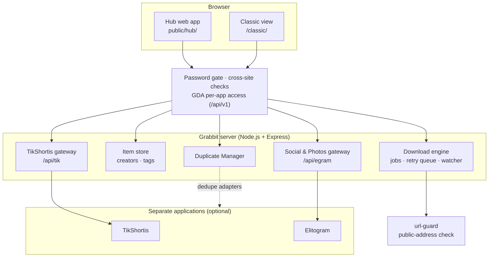
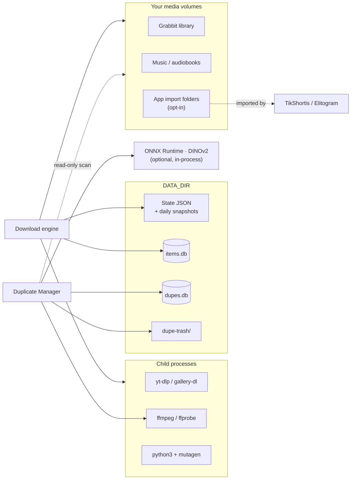

# Architecture

Grabbit is one Node.js (Express) process with a vanilla-JavaScript web app.
Downloads and media tools run in child processes (yt-dlp, gallery-dl, ffmpeg,
Python for tags); AI inference runs inside the server process. State lives in
`DATA_DIR`, and media lives in folders you mount. TikShortis and Elitogram are
**separate applications** with their own databases and media; Grabbit talks to
them through narrow gateways. On its side Grabbit keeps only the sealed
TikShortis and Elitogram sessions (HttpOnly cookies in your browser) and a
mirror of the creator classifications it uses to filter Social & Photos.

## Overview (implemented in 3.0.4)

The first diagram shows how a request travels; the second shows where the
work runs and where data is stored.

**Requests**

**Processes and storage**

## Components

| Component | Where | What it does |
|---|---|---|
| Hub web app | `public/hub/` | The 3.0 interface: Dashboard, Download, Queue & jobs, Media, Library, Profiles, Review, Inbox, Duplicates, Conversion, Metadata & tags, Distribution, Settings, plus TikShortis and Social & Photos when they are switched on, and the Adshortis 18+ and Adflix 18+ library viewers when their libraries are mounted. |
| Classic view | `public/index.html`, served at `/classic/` | The 2.x single-page app. Some download features (playlists, formats, scheduling, cookies, rules, notifications) are still configured here. |
| Download engine | `server.js`, `extractors/`, `premium-fallback.js`, `retry-queue.js` | Resolves links with site extractors and falls back to yt-dlp. The web UI runs downloads as background jobs with progress over Server-Sent Events, at most `MAX_ACTIVE_JOBS` at a time. The exception is the classic view's playlist and profile batch, which streams `/api/download-all` and downloads inside that request. The synchronous `/api/download` and `/api/download-all` endpoints for co-hosted apps also run in the request. |
| URL guard | `url-guard.js` | Submitted URLs must resolve to a public address unless `ALLOW_PRIVATE_ADDRESSES=1`. Guarded fetches (`safeFetch`) follow redirects by hand and re-check each hop. Some extractors use a plain fetch, in some cases on the matched URL you submitted (erome albums, for example). |
| Item store | `item-store.js`, `item-meta.js`, `source-meta.js` | SQLite (`items.db`, WAL) with one row per downloaded item: audience, creator, source record, tags and an edit log. |
| Profiles and audience | `profiles.js`, `audience.js` | Creator profiles with several platform accounts and aliases. Audience (general or 18+) is set by hand and only ever tightens. |
| Smart Duplicate Manager | `dupe-*.js`, `public/hub/dupes/` | Read-only scanner, photo/AI/video analysis, review UI, Smart Trash and restore. See the README section. |
| TikShortis gateway | `tikshortis-gateway.js`, `public/hub/tik/` | Native TikShortis pages. Requests pass a method and path allowlist to the TikShortis API; the TikShortis session is sealed in an HttpOnly cookie. |
| Social & Photos gateway | `egram-gateway.js`, `public/hub/social/` | Native pages over the Elitogram API. A request uses the general lane, or the review lane for unclassified content (`X-Egram-Audience`). Answers in both lanes are checked again against Grabbit's own 18+ profiles, and adult records are dropped. |
| GDA (per-app access) | `gda.js`, `gda-admin.js` | Passwords or bearer tokens per co-hosted app, each tied to an audience, targets and operations (`/api/v1/*`). |
| Module registry | `modules.js` | One list of hub modules, their audience and their switch. Planned modules are listed but never served. |

## Separate applications

| Application | Repository | Needed for | Without it |
|---|---|---|---|
| TikShortis | [tjelite1986/tikshortis](https://github.com/tjelite1986/tikshortis) | The native TikShortis pages (`TIKSHORTIS_MODE=native`) or the framed view (`embed`) | The TikShortis menu entry is hidden and `/api/tik` is not mounted. |
| Elitogram | [tjelite1986/elitogram](https://github.com/tjelite1986/elitogram) | Social & Photos (`EGRAM_MODE=native`) | The Social & Photos menu entry is hidden. |

Both are installed and run on their own. Grabbit can also drop finished files
into their import folders (`TIKSHORTIS_ROOT`, `EGRAM_IMPORT_DIR` with
`POSTS_TO_EGRAM=1`). The duplicate manager can ask them about shared copies
once each adapter has its three prerequisites: the shared token file
(`GRABBIT_DEDUPE_TOKEN_FILE`), the app's API URL and its library root. See
[the adapter settings](configuration.md#smart-duplicate-manager) in the configuration guide.

## Outbound network traffic

Grabbit contacts:

- the sites you download from (through yt-dlp, gallery-dl and the extractors);
- iTunes Search and Deezer, for music metadata lookups;
- GitHub, when you press **Get model** for the AI Photo Engine (if the
  model file goes missing or fails its check, press **Get model** again);
- your browser's push service, if you enable web-push notifications;
- TikShortis and Elitogram, if you configure them.

The duplicate analysis itself runs on your server. No media is uploaded for
analysis.

## Planned, not built

These are listed in `modules.js` with `planned: true`. They have no menu
entry and no routes in 3.0.4. The Adshortis 18+ and Adflix 18+ library
viewers that exist today are separate from the planned 18+ modules below.

| Module | Audience |
|---|---|
| Videos (native) | General |
| Movies & music | General |
| Home | General |
| Adshortis module and adult videos & photos | 18+, isolated from general modules by design |

The Conversion page lists the tools it found. Its conversion queue is marked
as planned.
