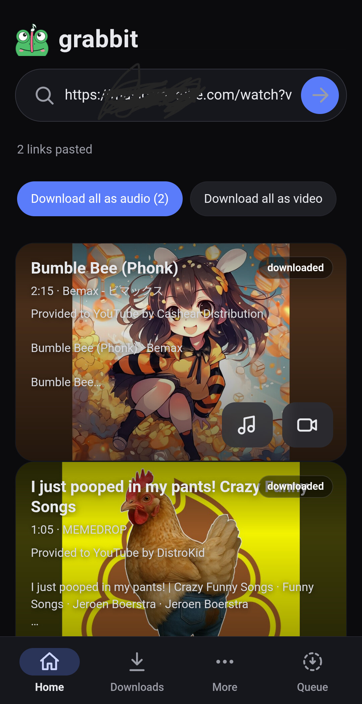
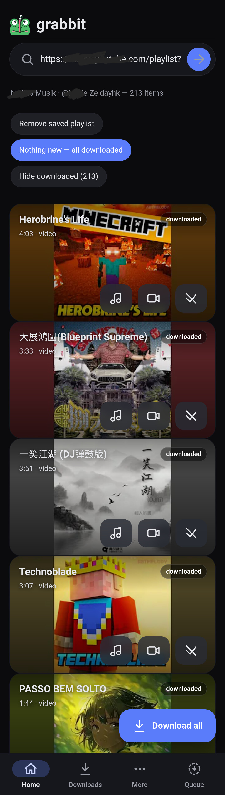
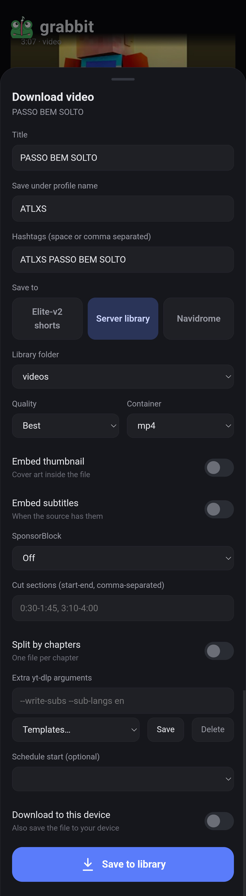
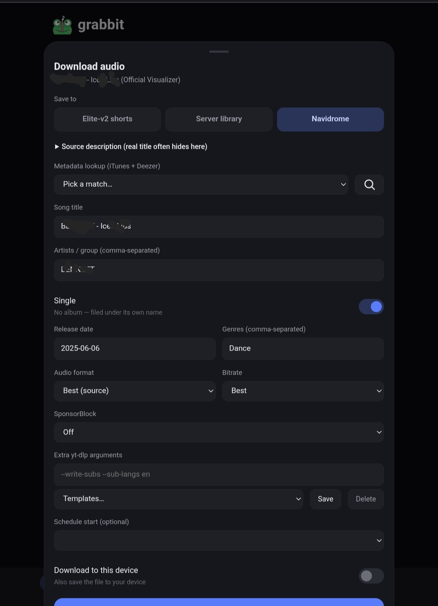
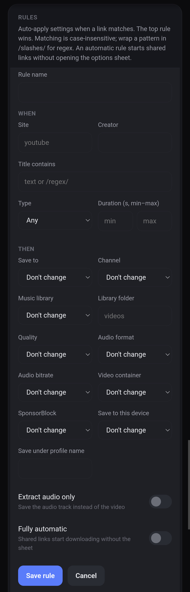
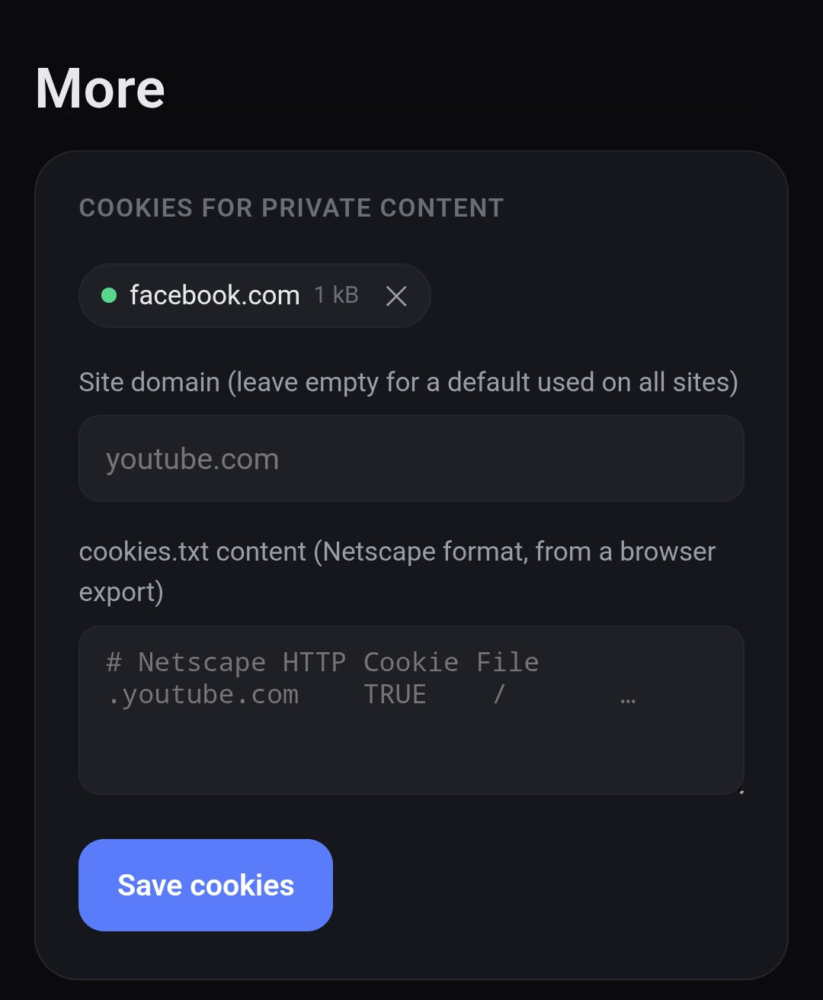
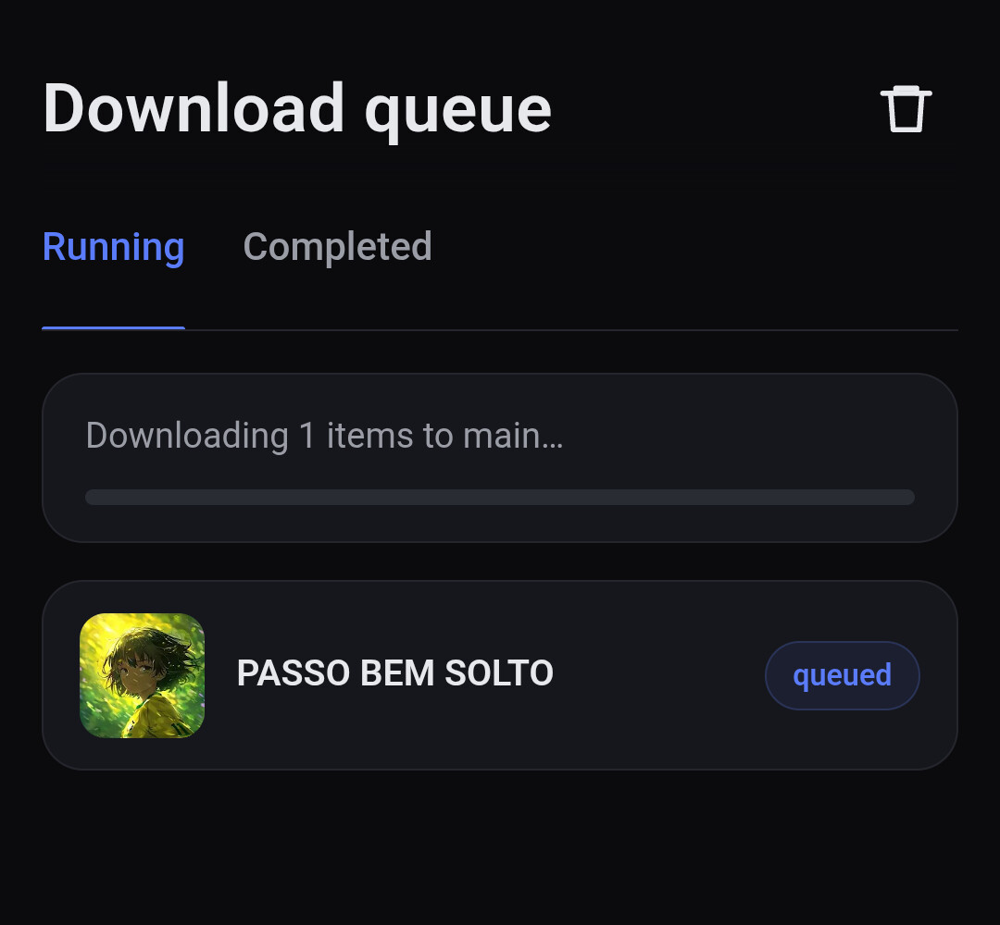
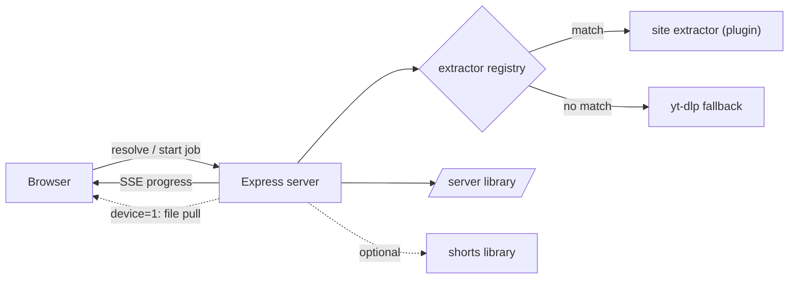

# Grabbit user guide

This guide explains the download side of Grabbit in detail: the classic view,
every download option, rules, cookies, errors, how the download engine works
and how to add a site. It was carried over from the 2.x README and still
applies to 3.0.4, where these features live in the classic view (`/classic/`)
and in the hub's Download, Queue and Media pages.

For installation see [installation.md](installation.md). For every setting see
[configuration.md](configuration.md). For an overview of the 3.0 hub, see the
[README](../README.md).

## Grabbit 2.0 hub

The hub is the start page (`/`): a front end over the same API with a dashboard
of counts from the downloaded registry, a paste-a-link box, the live job queue,
the latest downloads, creators found in file names, app destinations, system
status, and the Media, Review, Profiles, Inbox, Duplicates and Metadata & tags
pages. Every number comes from the server.

The classic interface lives at `/classic/`, keeps every feature and is linked
from the hub's sidebar. It still owns the share target (`/share`) and the app
shortcuts; the old deep links `/?tab=…` and `/?action=…` (installed apps, push
notifications) are redirected to `/classic/` with their query. `/hub/`, the
hub's address before it became the start page, redirects to `/`.

### Media viewer

A click on a tile in the hub's *Media* page plays the video or shows the picture
in place: native video controls (play, seek, volume, full screen, inline on
phones), zoom and pan for pictures (wheel, double click or double tap, pinch,
drag), next and previous by button, arrow key or swipe, and a details panel with
creator, platform, original URL, format, size, resolution and the item's
classification. Next and previous stay inside the page's filter, so with the
audience filter set to *General* no 18+ item comes up.

Files are served as they are; nothing is converted. Where an app keeps a
browser copy beside the original (`<name>.web.mp4`), the viewer offers both and
starts with the web copy. The browser asks for a history entry id and a variant
(`original`, `web`, `poster`), never a path: the server looks in the folders the
entry's save channel writes to and serves a file only when its real path lies
inside a configured root (a symlink out of a library is refused). The routes
are for the main session only; app passwords get 403. A file an importer has
already taken out of its drop folder (Adshortis, Platform) shows as no longer
on the server.

### The 18+ destination (Adshortis)

Adshortis is a destination of its own, never mixed with the general apps:

- The hub lists it in a separate *18+ only* group, only when `ELITE_ROOT` is
  set and passed the boot check, and never restores it as the default choice.
  Saving to it needs a confirmation tick, every time.
- Its folder may not share a tree with a general destination; if it does, the
  channel is disabled at boot (see `ELITE_ROOT` below).
- Only the owner session and app clients with the `adult` audience can save to
  it (GDA target `adshortis.inbox`); a general client is refused.
- A save to it is refused up front when it is not available, and an 18+ image
  is refused instead of going to the general posts import.

### The audience gate

Every item has an audience: `general`, `adult` or `unknown`. Before anything is
written into an app's folder, Grabbit works out the item's audience and checks
it against the app (`audience.js`). The check runs when the save starts and
again right before the file lands.

- **Adult wins.** An item is adult when the save goes to Adshortis, when it was
  recorded as adult before, when it comes from an 18+ site, when the site
  itself flags it 18+ (yt-dlp's `age_limit`), or when its creator matches a
  profile that is 18+ or was classified 18+. Once adult, an item stays adult.
- **General is a decision by hand.** An item is general only when its creator
  matches a general profile that was created by hand or classified general on
  the hub's *Review* page, or when the item itself was classified general
  there. Having been delivered to a general app before is not a
  classification, and neither is a save to the plain server library.
- **Unknown is not general.** A creator no one has classified, or an item with
  no creator, is refused by every general app (Tikshortis, Platform, the posts
  import). Classify it on the *Review* page, or save to Adshortis or the
  server library.
- **18+ is final.** An 18+ creator or item is never classified general again,
  and 18+ and other profiles are never merged.
- **A job can tighten, never loosen.** Saving to Adshortis makes the item
  adult. Renaming the creator (`creator=`) cannot borrow another creator's
  general profile: both the site's name and the new name are checked, and the
  stricter answer wins.
- Adshortis takes videos only.

**Review page.** The hub's *Review* page lists unclassified creators (most
files first) and the items a general app refused (latest refusal first). Tick
creators or items and classify them general or 18+, or classify every
unclassified creator that matches a filter at once; that bulk action states
the count you saw, and is refused if the list changed meanwhile.

**Kids library.** A child-safety rule for the Navidrome kids library
(`kidsRefusal()` in `audience.js`: only items classified general, never
unknown or 18+) is written and tested but not switched on; the kids library
works as before.

Items and deliveries are recorded in `items.db` (SQLite, WAL) in the data
directory. The database refuses on its own any general delivery of an item that
is not general, and any lowering of an adult item. On boot, items are imported
from `downloaded.json` (read only; nothing is added to or changed in the JSON
files). Before a schema migration the existing database is copied to
`items.db.pre-v<N>-<time>`, and a database newer than the code is refused. The
daily state snapshot includes a consistent copy of `items.db`. If `items.db`
cannot be opened, general apps receive nothing until it can; `/api/health`
shows the reason under `items`.

Content hashes (SHA-256) are recorded for each delivered file. A file with the
same bytes as an earlier item is logged as a duplicate; nothing is refused on
that yet.

### Creator profiles

The hub's Profiles page manages one profile per creator, stored in
`profiles.json` in the data directory (snapshotted daily with the other state
files). A profile holds:

- **Linked accounts**: any number of platform accounts (`tiktok`, `instagram`,
  `facebook`, ...), each with a handle, an optional profile link and where it
  came from (`manual`, or the importer that added it).
- **Aliases**: the creator names found in downloaded file names
  (`<creator>_-_<title>`). Every creator in the downloaded registry gets a
  profile of its own the first time the page is opened, and new creators are
  added as they appear.

Edit renames a profile and changes its accounts. Merge moves the aliases and
accounts of other profiles into one and remembers the merged ids. Split moves
chosen aliases or accounts out into a new profile. The rules:

- Nothing on disk changes. Files are never renamed or moved, and the registry is
  only read.
- An alias is only ever moved, never deleted, so every file name's creator
  always resolves to exactly one profile.
- One platform account belongs to one profile. Adding it to a second profile is
  refused with a hint to merge instead.
- General and 18+ are kept apart. A file saved to the `18plus` channel makes its
  creator an 18+ alias, so the same name in both channels becomes two profiles,
  and merging across audiences is refused. A profile created by hand must be
  given its audience explicitly.

API (web session only; app passwords are refused):
`GET /api/hub/profiles?q=&audience=general|adult`, `GET /api/hub/profiles/:id`,
`POST /api/hub/profiles` (`{ name, audience, note?, accounts? }`),
`POST /api/hub/profiles/:id` (`{ name?, note?, accounts? }`),
`POST /api/hub/profiles/merge` (`{ target, sources: [id] }`),
`POST /api/hub/profiles/:id/split` (`{ name, aliases: [name], accounts: ['platform:handle'] }`).


## Everyday use

A few things the web UI does that aren't obvious at first glance.

**Paste one link — or many.** One link resolves to a single card. Paste several
and Grabbit lays them out as a batch, queuing every one with the same settings.
The links can be on separate lines, spaced out, or run straight together with no
separator:

```
https://www.example.com/share/r/19EBzS35RK/
https://www.example.com/share/r/19EBzS35RK/
https://www.example.com/share/r/19EBzS35RK/
```

```
https://www.example.com/share/r/19EBzS35RK/https://www.example.com/share/r/19EBzS35RK/https://www.example.com/share/r/19EBzS35RK/
```

The second form takes no spacing to get right, which makes it much easier to
build up a list on a phone or tablet.



**Download straight into a music server.** If you run your own music server such
as [Navidrome](https://www.navidrome.org/), point the music destination at its
library folder and Grabbit files each track into a clean, scannable tree:

```
[Artist]/[Album (Year)]/[Artist] - [Album (Year)] - [Title].ext
```

(Artist and album repeat in the file name on purpose, so a track stays
identifiable even if it ends up outside its folder.)

**Audiobooks and audio stories get their own shelf.** The *Audiobooks /
stories* destination is a separate library where every book or story lives in
its own folder:

```
[Author]/[Book]/[NN - ][Part].ext
```

A story that arrives as a single file keeps the plain book name; a book that
comes as one long recording can be split on its chapters (**Split by chapters**
in the download sheet), and each chapter lands as a numbered, individually
tagged part of the same book. Adding a part later continues the numbering
instead of overwriting part one, and the source thumbnail is saved as
`cover.jpg` next to the book, which is what audiobook players look for.

**Auto or hand-picked metadata.** Leave tagging on **auto** and Grabbit names
and tags the track for you. Prefer to curate it? Do it manually and pick the
right match from a metadata lookup list — set the genre, mark it as part of an
Album, Single or EP, and check the source description, where the real title is
often hiding.

**A site that won't download?** Most links already work through the built-in
yt-dlp fallback, but a stubborn site can be taught with a small custom extractor
— see [Adding a new site](#adding-a-new-site), which also covers the easiest
route: letting an AI agent write it for you.

### Playlists, subscriptions and bulk downloads

Paste a **playlist** or a **creator/profile** link and Grabbit doesn't resolve a
single file — it lists *every* item in it as a card, with batch actions on top.
This is how you grab a whole channel, playlist or profile at once.



**The item list.** The header shows the playlist/profile name, the handle and how
many items it holds. Each card has:

- an **audio** button and a **video** button (image items get an **image**
  button instead) — tap either to open the download sheet for just that one item;
- a **✓ mark-as-downloaded** toggle. Grabbit remembers what you've already
  grabbed so you can tell new from old at a glance; tap again to clear the mark.

**Batch actions across the whole list:**

- **Download all** (the floating button, bottom-right) — opens the download sheet
  once for *every* item in the list. Whatever you set there is shared by all of
  them, and each file still names and tags itself from its own metadata (so the
  per-item title/tag fields are hidden in a batch).
- **Download new to Navidrome (N)** — queues every item you *haven't* downloaded
  yet as tagged audio into your music library, skipping the ones already done
  *and* the ones whose song is already in the library under another upload.
  Disabled when there's nothing new. `(N)` is how many are fresh.
- **Hide downloaded (N) / Show all** — collapse the items you've already grabbed
  so only new ones show. The choice is remembered between visits.

**"Download all as audio" vs "Download all as video".** When you paste several
links at once you get both buttons, and the difference is exactly what it says:

- **Download all as audio** — extracts *only the sound track* of each link. Use
  this for music, podcasts or anything you only want to listen to: the files are
  much smaller, and the sheet gives you the audio-specific options (audio format
  + bitrate). Each track is named and tagged from its own metadata.
- **Download all as video** — downloads the *full video* (picture + sound) of
  each link, at the quality and container you choose in the sheet.

Both open the same shared-settings sheet; the only difference is whether you end
up with audio files or video files. (Sending a batch to the **Navidrome** music
destination always extracts audio, whichever button you started from — a music
library holds songs, not video.)

**Subscribing to a playlist.** In a playlist view, tap **Save playlist** (it
becomes **Remove saved playlist** once saved). Saved playlists live under
**More → Saved playlists**, where each row gives you:

- **Tap the row** — re-open the playlist to look through it and check for new
  items by hand.
- **The library pill (`Mine` / `Kids`)** — tap to switch which Navidrome library
  this playlist's new tracks go into (your own or the separate kids library).
- **The bell (watch) toggle** — turn on **auto-download**: Grabbit then polls the
  playlist on an interval (`WATCH_INTERVAL_MINUTES`) and downloads any newly
  added track to Navidrome on its own, as tagged audio — no need to come back.
  Off means the playlist is just saved for easy re-opening, nothing downloads by
  itself.
- **The trash icon** — remove the saved playlist (this only unsubscribes; it
  never touches files you've already downloaded).

### The music log and "do I already have this song?"

Two different questions, answered by two different files in `DATA_DIR`:

- `downloaded.json` — **have I fetched this source before?** Keyed by the clip's
  URL and its site-native id. It is what marks playlist items as *downloaded*
  and what the watcher skips.
- `music.json` — **which songs are in my music libraries?** One row per track:
  library, path, artist(s), title, album, year, genres, and the source URL it
  came from. Unlike the download history (capped at the last 200 downloads of
  any kind) this log is never trimmed, so it stays a complete record.

**Downloads → Music** lists that log — each row under the track's own cover
art, extracted from the file once and cached as a small JPEG in
`DATA_DIR/covers` (a scan pre-extracts what is missing, a few at a time, and
drops covers no track claims any more). Search across artist/title/album, filter
by library, and **Rescan** to reconcile it with what is actually on disk.

**Working through the library.** Each row carries two review markers, for
cleaning up a library a bit at a time:

- an **edited** badge with the time, on every track whose tags were changed here
  — so a pass over a badly tagged import shows what has already been fixed;
- a **tick** button that marks a track as dealt with (dimmed and struck through).
  Saving an edit ticks the track off on its own; tracks that were fine as they
  were can be ticked off without touching them, and a tick can be undone.

The chip next to the library filter cycles **All tracks → Needs a look → Ticked
off → Edited here**, and the line above the list counts how many are ticked off
and how many were edited. Both markers live in the music log only — nothing on
disk changes. A scan
walks both music roots, reads the tags of anything the log has not seen (so
files copied in by hand, or downloaded before the log existed, still show up)
and flags rows whose file has since disappeared. One scan also runs shortly
after every start, and **More → Music library** has the same scan next to the
current track count and the time of the last one.

**Editing a track you already have.** Every row in the music list has a pencil
button: it opens the same tag fields the download sheet uses — song title,
artists, release type, album, date, genres (with the picker) and which library
the track belongs to — but applies them to the file that is already on disk. No
download happens: the tags are rewritten in place (cover art survives), the file
is re-filed under the layout the new tags imply, the folders it left behind are
removed if empty, and the music log follows along. The iTunes/Deezer lookup is
available there too, so a badly tagged rip can be fixed from a database match,
and the track's **description** is shown above the fields — the text embedded in
the file, or failing that the source page's own description, which is where the
real artist and title usually hide when the video title is clickbait. Grabbit
refuses the save if another track already sits under the new name.

**Duplicate detection.** The same song is uploaded many times — a topic channel,
an official video, a lyric video — and each of those is a *different source*, so
the downloaded registry cannot recognise it. Grabbit therefore also matches
against the music log by **artist + title**, ignoring the noise video titles
carry (`(Official Music Video)`, `[Lyrics] HD`, an `Artist - ` prefix, the
`- Topic` channel suffix). What happens with a match:

- a **full match** (artist *and* title) shows *in library* on the item card, is
  excluded from *Download new to Navidrome* and is skipped by the watcher;
- a **title-only match** (the artist reads differently on the two sides) is only
  a warning in the download sheet — never a reason to skip a track by itself.

Both sides are read generously, because a rip is filed under whatever the site
gave it: a credit line is compared per artist as well as whole (`Rocco,
Pulsedriver & Ninkid` also matches plain `Rocco`), a library track is indexed
under every reading of its title (so `STARSET - Brave New World (Official Music
Video)`, saved under the channel `starsetonline`, is also found as `Brave New
World`), and a title-only hit counts as a full match when one side names the
other's artist inside its title — which is exactly what a channel-tagged rip
looks like.

A suffix that means a *different recording* — `(Live …)`, a remix name — is
deliberately kept, so those are not treated as duplicates of the studio version.

### Default download options — every setting explained

These live under **More → Default download options**. They set the *starting
point* for every new download: the options sheet opens pre-filled with them, you
can still change anything per download, and a matching [rule](#rules--automate-the-settings-youd-otherwise-pick-every-time)
can override them. Each change saves the instant you make it — there's no separate
save button.

Some rows only appear when they're relevant (e.g. the music-library picker shows
up only once the destination is Navidrome); that's noted per setting.

- **Save to** — the destination new downloads go to. This choice also decides
  which of the rows below are shown.
  - *Shorts* — the short-clip library of a co-hosted app. Each channel has its
    own root, so *main* and *18+* can be served by different apps.
  - *Server library* — a plain folder library on the server.
  - *Navidrome (music)* — a tagged music library: audio only, filed by
    artist/album (see the naming scheme above).
  - *Audiobooks / stories* — a tagged audiobook library: audio only, one folder
    per book, filed by author/book (see the naming scheme above).

- **Music library** — *shown only when Save to = Navidrome.* Which music library
  the audio lands in: *My music* or *Kids* (a separate library/instance).

- **Channel** — *shown only when Save to = Shorts.* Which shorts channel new
  clips post to: *main* or *18+*. Each is its own app with its own root — see
  `TIKSHORTIS_ROOT` / `ELITE_ROOT`. Only the channels whose root is configured
  are shown, and with neither set the *Shorts* destination is hidden entirely.
  The 18+ channel takes videos only: an 18+ image is refused rather than filed
  into the general posts import.

- **Library folder** — *shown only when Save to = Server library.* The subfolder
  inside the server library that video downloads are filed under.

- **Quality** — the resolution **cap** for downloads from yt-dlp sites. *Best*
  takes the highest available; pick a number (2160p/4K down to 360p) to cap it
  there — handy to save space or bandwidth. Sites with a dedicated extractor
  hand over their own single quality, so this only affects yt-dlp links.

- **Video container** — *shown only when Save to = Server library.* The file
  format video is saved as: *mp4* (most compatible), *mkv* or *webm*. mkv and
  webm need a yt-dlp remux, so they apply to yt-dlp downloads.

- **Audio format** — the format for audio-only downloads. *Best (source)* keeps
  the original track without re-encoding (fastest, no quality loss); the others
  force a format — lossy (*mp3*, *opus*, *aac*, *vorbis*, *m4a*) or lossless
  (*flac*, *wav*, *alac*).

- **Audio bitrate** — the target bitrate for **lossy** audio only; it has no
  effect on lossless formats or on *Best (source)*. *Best* lets yt-dlp decide;
  otherwise pick from 320k (highest quality, biggest file) down to 96k
  (smallest).

- **Download to this device** — *on by default.* When on, the finished file is
  also streamed to the device you're using, on top of the server copy. Turn it
  off to keep the file only on the server and skip pulling it to your phone/PC.

- **Convert to web format** — save the download already as a web-optimized
  `.web.mp4`, ready to play in a browser without a later transcode pass (it skips
  the separate transcoder step).

- **Notify when done** — *shown only after you've enabled push notifications.*
  Sends a push notification when a download finishes.

### The download sheet — every field explained

When you tap a download action on a resolved link (audio / video / image), or a
batch button on a playlist/multi-paste, the **options sheet** slides up. It's
pre-filled from your [default download options](#default-download-options--every-setting-explained);
anything you change here applies to **this download only**. The button at the
bottom starts it.



The sheet is context-aware: it only shows the fields that make sense for what
you're downloading and where it's going, so you'll never see all of these at
once. Each entry below says when it appears.

**Naming and tagging**

- **Title** — the file/clip title. *Shown for a single link or one item picked
  from a profile; hidden for Navidrome and for batch/multi runs* (there each item
  keeps its own title).
- **Save under profile name** — files the download under a creator/profile name.
  *Hidden for Navidrome and multi-link runs.*
- **Hashtags (space or comma separated)** — tags that feed the clip's
  caption/keywords. *Hidden for Navidrome (which uses genres instead) and for
  batch runs.*

**Where it goes**

- **Save to** — the destination for this download: *Shorts*, *Server
  library*, *Navidrome* or *Audiobooks*. This choice drives which fields below
  appear.
- **Music library** — *Navidrome only.* *My music* or *Kids*.
- **Channel** — *Shorts only.* *main* or *18+*.
- **Library folder** — *server-library video only.* Pick an existing subfolder,
  or choose *New folder* to reveal…
- **New folder name** — *shown when Library folder = New folder.* Names the
  subfolder to create.

**Music tagging** *(the whole block shows only for a single Navidrome save — not
batches, which tag each track automatically from its own metadata)*



- **Source description** — a collapsible panel showing the original post's
  description, where the real song title often hides when the video title is
  clickbait.
- **Metadata lookup (iTunes + Deezer)** — a dropdown of matches from a music
  database; picking one fills every tag field below at once. The button beside it
  re-runs the search. Each row is marked by how well it answers: `✓` matched both
  the artist and the title, `≈` matched the artist and a title one typo away
  (found in that artist's own catalogue, so `Eyes Dem Open` still finds
  `EYES THEM OPEN`), `~` matched the title alone, `?` neither. Only `✓` and `≈`
  fill the fields on their own — a near miss stays pickable but is never written
  for you, because searching a common word answers with somebody else's song. The search is built from the artist and title fields (plus the
  channel name), not from the raw video title, whose brackets and genre words no
  catalogue indexes.
  When the fields are still empty, Grabbit reads the credit line out of the video
  title itself (`Artist – Track (Official 2026)`), so a track that only ever
  existed on its artist's channel still arrives tagged. If no database knows it
  either, the genre field falls back to the genres named in the video's own tags.
- **Song title** — the track title tag.
- **Artists / group (comma-separated)** — one or more artists.
- **Release type** — *Album*, *Single* or *EP*. A *Single* has no album and is
  filed under its own name (the album field disappears); *EP* relabels the field
  to *EP name*.
- **Album / EP name** — *hidden for Single.* The album/EP the track belongs to.
- **Release date** — `YYYY` or `YYYY-MM-DD`; the year becomes the `(Year)` in the
  folder path.
- **Genres (commas, spaces or #hashtags)** — one or more genre tags, written
  with whichever separator you have at hand: `#neurofunk #darkdnb #dnb`,
  `neurofunk darkdnb dnb` or `Pop, Rock`. The separator is taken from the text
  itself — hashtags win, then commas/semicolons, and only a line with neither
  is split on spaces. Multi-word genres therefore need a comma or a hashtag
  (`#hard rock #dnb`), except when a connector makes the name obvious
  (`Drum & Bass`, `Rhythm and Blues`), which is kept whole. Duplicates are
  dropped.
- **Pick genres from list** — opens every genre Grabbit knows, most-used first
  with a track count: the genres already in your music libraries plus the ones
  you have typed here before (kept in `DATA_DIR/genres.json`). Tap to add or
  remove; the field is rewritten in whichever style it already uses (hashtags
  or commas), so typing and tapping mix freely.

**Audiobook tagging** *(shows only for a single Audiobooks save — not batches,
where each item names its own book from its own metadata)*

- **Source description** — the same collapsible panel as above. Worth opening
  for a book: audiobook uploads usually spell out the author, the narrator and
  the chapter timestamps there, and those timestamps go straight into *Cut
  sections* further down.
- **Author / narrator** — becomes the artist tag and the top folder level.
- **Book / story title** — becomes the album tag and the book's own folder.
  Editing it also retitles the part, until you edit the part by hand.
- **Part title** — names the file and its title tag. A story that arrives as one
  file can keep the book title. *Hidden when Split by chapters is on*, since
  each chapter then titles itself.
- **Year** and **Genres** — as for music; an empty genre defaults to
  `Audiobook` rather than being looked up in a music database.

**Quality and format**

- **Quality** — resolution cap for yt-dlp sites (*Best* or 2160p…360p). *Shown
  for video, non-Navidrome.*
- **Container** — output format *mp4 / mkv / webm*. *Server-library video only*
  (Elite shorts stay plain mp4; mkv/webm need yt-dlp).
- **Audio format** + **Bitrate** — same choices as the defaults; bitrate applies
  to lossy formats only. *Shown for audio downloads* (including a Navidrome or
  Audiobooks save, which always extract audio; audiobooks default to `m4a`).

**Video extras** *(server-library video only)*

- **Embed thumbnail** — write the cover art inside the file.
- **Embed subtitles** — include subtitles when the source has them.

**SponsorBlock** — *shown for server-library video or any audio extraction.*
*Off*, *Remove segments* (cut sponsor/intro/etc. out) or *Keep, mark as chapters*
(leave them in but add chapter markers).

**Cutting** *(server or audiobook library, not images, not batches)*

- **Cut sections (start-end, comma-separated)** — download only the given
  timestamp ranges, e.g. `0:30-1:45, 3:10-4:00`. Because a cut can produce
  several files, only the server and audiobook libraries take it.
- **Split by chapters** — *video, or any audiobook save.* Save one file per
  chapter instead. For an audiobook each chapter becomes a numbered part inside
  the book's folder, tagged individually.

**Advanced and delivery**

- **Extra yt-dlp arguments** — pass extra flags straight to yt-dlp, e.g.
  `--write-subs --sub-langs en`. Only an allowlisted safe subset of long options
  is accepted; you can save named **Templates** (Save/Delete) to reuse a flag set.
  *Shown for anything except images; ignored by sites with a direct extractor.*
- **Schedule start (optional)** — a date/time to hold the job until; it waits as
  *scheduled*, survives restarts, and can be cancelled from the queue. *Hidden for
  the download-all batch.*
- **Convert to web format** — save a web-ready `.web.mp4` immediately, skipping
  the later transcoder pass. *Elite-v2 video saves only.*
- **Download to this device** — *on by default.* Also stream the finished file to
  your device, not just the server. *Hidden for the download-all batch.*

**The confirm button** relabels itself for the context — *Download & import*,
*Save to library*, *Save to Navidrome*, *Download all (N)*, and so on — so it
always says exactly what pressing it will do. A **warning banner** may appear
above the fields when something's worth knowing before you commit: the clip is
too long for shorts (so it's routed to the server library instead), or it's
already been downloaded/imported.

### Rules — automate the settings you'd otherwise pick every time

Under **More → Rules** you can teach Grabbit to fill in the download options for
you whenever a link matches. Each rule is a simple *when this → then that*: a set
of match conditions and the settings to apply when they're met.



**How matching works:**

- A rule has a **When** block (the conditions) and a **Then** block (the settings
  to apply). Leave every When field empty and the rule matches *everything*.
- All the conditions you do fill in must match (they're AND-ed together).
- Matching is **case-insensitive substring** by default — `youtube` matches
  `www.youtube.com`. Wrap a pattern in `/slashes/` to use a **regex** instead,
  e.g. `/(mp3|flac)$/` on the title.
- Rules are checked **top to bottom, and the first enabled match wins**, so put
  your most specific rules above the broad catch-all ones. Drag to reorder.

**What you can match on (When):** site, creator, title contains (text or
`/regex/`), media type (video/image), and a duration range in seconds (only
applies to links whose length is known).

**What you can set (Then):** destination (shorts / server library /
Navidrome music), channel (main / 18+), music library (mine / kids), a library
subfolder, quality, audio format + bitrate, video container, SponsorBlock
(remove or mark), save-to-this-device, a profile name to file it under, and an
*extract audio only* toggle. Anything left on **Don't change** keeps the normal
default. A rule only touches the fields you actually set.

**Automatic rules.** Flip **Fully automatic** on and a matching *shared* link
starts downloading immediately with the rule's settings — the options sheet
never opens. Leave it off and the rule just pre-fills the sheet, so you still get
a chance to review before hitting download.

**Examples:**

- *Send music straight to Navidrome.* When **Site** = `youtube` → Then
  **Extract audio only** on, **Audio format** = `opus`, **Save to** =
  `Navidrome (music)`, and **Fully automatic** on. Now sharing a YouTube link
  files a tagged track into your music library with zero taps.
- *Keep long videos out of shorts.* When **Type** = `Video`, **Duration min** =
  `1200` → Then **Save to** = `Server library`, **Quality** = `1080p`.
- *Route one creator to the 18+ channel.* When **Creator** = `somename` → Then
  **Channel** = `18+`. Put this above any broader site rule so it wins.

### Unlocking private or login-only content with cookies

Some links only resolve when you're signed in — members-only videos, private
playlists, age-gated pages, premium audio. Grabbit can borrow your browser's
login by using an exported `cookies.txt` file. Every yt-dlp call — resolve,
download and playlist polling — then reuses it automatically, so login-gated
content just works.



**Getting a `cookies.txt` file.** It has to be in the classic *Netscape* format,
which a small browser extension produces in one click:

1. Sign in to the site in your browser as usual.
2. Install a "cookies.txt" exporter extension — for example *Get cookies.txt
   LOCALLY* (Chrome/Edge) or *cookies.txt* (Firefox). Pick one that exports the
   **Netscape** format and keeps the data on your machine.
3. Open the site and click the extension. You don't have to download a file —
   *Get cookies.txt LOCALLY* has a **Copy** button that puts the cookies on your
   clipboard, ready to paste straight into Grabbit.

**On a phone or tablet.** Most mobile browsers can't run extensions, but
[Ultimatum](https://github.com/gonzazoid/Ultimatum) (Android) can. Download the
*Get cookies.txt LOCALLY* plugin and load it into Ultimatum, then sign in to the
site, tap the extension's **Copy** button, and paste — no cookies file to save,
no desktop needed.

**Adding them to Grabbit.** Go to **More → Cookies** (the *Cookies for private
content* panel) and fill in the two fields:

1. **Site domain** — type the site the cookies are for, e.g. `example.com`.
   Leave it empty instead to save a *default* file that's used on every site.
2. **cookies.txt content (Netscape format, from a browser export)** — paste the
   text you copied with the extension's **Copy** button.
3. Click **Save cookies**.

That's it — the file appears in the list above the form, and matching downloads
start using it right away. You can keep one default plus any number of per-domain
files side by side; Grabbit picks the matching one for each download on its own,
and each saved file has a delete button when you want to remove it.

A couple of things worth knowing:

- **Use a throwaway account** where you can. Cookies are live login sessions —
  treat the file like a password, and don't hand a site your main account if a
  spare will do.
- Cookies expire. If a previously working link starts failing on login again,
  re-export and paste a fresh file.
- Stored files are never touched in place — each download gets its own temp
  copy, so running several jobs at once can't corrupt the saved cookies.

## Errors and how Grabbit handles them

A download happens in two stages, and it helps to know which one failed:

1. **Resolve** — Grabbit reads the link's metadata (title, creator, duration).
   This is also where it learns whether the content is even reachable.
2. **Download** — the file is actually fetched and saved.

Grabbit's guiding rule: **recover from anything temporary on its own, and be
blunt about anything permanent** so you're not left staring at a stalled job.
A resolve problem shows up right on the card; a download problem shows in the
**Queue** with the job's message.



### Common messages

| What you see | What it means | What Grabbit does — and what you can do |
| ------------ | ------------- | --------------------------------------- |
| `Invalid URL` | The box didn't contain a usable link. | Nothing runs. (Plain words instead of a link trigger a video *search*, not this error.) |
| **"The site refused this video: … — downloading will fail too"** (red card notice) | The site won't hand the video over at all — it's deleted, private, members-only, behind a login, or geo-blocked. The download uses the same extraction, so it can't succeed either. | Grabbit warns you **before** you start, instead of failing halfway. If it's login-only, add cookies (**More → Cookies**); otherwise try again later or find another upload. |
| **"No metadata: … — the download may still work"** (amber card notice) | Only the metadata probe hiccupped (a timeout, an unreadable field). This says nothing about the download itself. | Grabbit still lets you download; just the title and creator show as unknown until it finishes. |
| `only available to Music Premium members` (YouTube Music) | An auto-generated track ID is premium- or region-locked, even though the same recording usually exists under a free ID. | Grabbit **automatically** looks up a free counterpart (via music.youtube's redirect, then a track search), checks it actually plays, and copies the original's clean artist/title onto it for tagging. Only if no free copy exists does the error stand. |
| `Video unavailable` (YouTube) | Often just an intermittent YouTube flake; sometimes a genuine removal. | Grabbit **re-probes once** after a short pause before giving up. A real removal still fails after the retry. |
| `not available in your country` / `blocked in your country` | Geo-restriction. | Can't be bypassed from here — it needs cookies or a network from an allowed region. |
| `HTTP Error 403` / `429 Too Many Requests` / `timed out` / `Connection reset` / `ETIMEDOUT` … | A temporary network or rate-limit failure — common when a big batch hammers one site at once. | Grabbit **retries automatically**, up to 3 attempts, waiting longer each time (the queue shows `Retrying (1/2)…`). The queue also caps how many downloads run at once to ease the pressure. |
| `This video is … long — too long for shorts` | The clip is longer than `SHORTS_MAX_DURATION`, the cap for the *shorts* destination. | Grabbit routes it to the **server library** instead (a notice tells you). In a batch, clips already known to be too long are skipped. |
| `Cutting needs a yt-dlp-handled site (this one uses a direct downloader)` | You asked to cut or split a site that Grabbit downloads directly, not through yt-dlp. | Cutting/splitting only works on yt-dlp sites — download the file whole instead. |
| `yt-dlp produced no output (no matching sections/chapters?)` | Your cut ranges matched nothing, or the video has no chapters to split. | Double-check the timestamps, or that the video actually has chapters. |
| `Bad cut section "…" — use start-end like 1:30-2:45` / `Too many cut sections (max 20)` | The **Cut sections** field is malformed. | Give `start-end` ranges, comma-separated, up to 20. |
| `Extra argument "…" is not allowed` / `… needs a value` / `… does not take a value` / `Too many extra arguments` | An **Extra yt-dlp arguments** entry was rejected by the safety allowlist. | Only a safe subset of long flags is accepted (no short flags, unknown options or stray URLs). Remove the flagged one. |
| `Empty cookie file` | You pressed **Save cookies** with nothing pasted. | Paste the `cookies.txt` content first. |
| `No results for "…"` | A plain-words search came back empty. | Refine the search terms, or paste a direct link. |
| `Unauthorized` | Wrong or expired web-UI password. | Re-enter the Grabbit password. |

### What runs on its own

Three of the rows above are worth calling out, because Grabbit handles them with
no action from you:

- **Automatic retries with back-off.** Transient download failures (403, 429,
  timeouts, dropped connections, 5xx) are retried up to three times, each after a
  longer pause — so a rate limiter that's momentarily busy with the rest of your
  batch usually clears by the next attempt. Only a non-transient error, or the
  third strike, marks the job failed. Failed and cancelled jobs also keep a manual
  **retry** button in the queue.
- **YouTube re-probe.** Because YouTube intermittently reports playable videos as
  "unavailable", Grabbit quietly probes a second time before trusting the error.
- **Free-counterpart swap for premium locks.** Premium/region-locked YouTube
  Music IDs are transparently replaced with a verified free upload of the same
  track, tagged from the original — you just get the song.

## How it works — under the hood



1. `GET /api/resolve?url=...` picks the matching extractor and returns metadata
   (incl. `duration` and `tooLongForShorts`).
2. The web UI starts a **background job** (`GET /api/jobs/start?...`) and watches
   progress over SSE (`GET /api/jobs/stream`). The download runs server-side, so a
   long file no longer has to finish within the gateway timeout. When a job is
   done and `device=1`, the browser pulls the finished file from
   `GET /api/jobs/:id/file` (the file is already on disk, so bytes flow at once).
3. `GET /api/download?url=...` (synchronous, returns JSON or streams the file) and
   `GET /api/download-all` (SSE batch) are kept for elite-v2's internal grab
   integration, which calls Grabbit over the docker network (no gateway timeout).

Any URL no dedicated extractor claims falls back to yt-dlp automatically.

A few design choices worth knowing about:

- **Plugins over a monolith.** Each supported site is one file in
  `extractors/` exporting `match()` + `resolve()`; the registry auto-loads
  them. The generic yt-dlp extractor is just the plugin that matches last.
- **Jobs, not requests.** Downloads never run inside the HTTP request that
  started them. A job survives the browser tab closing, reports progress over
  SSE, persists scheduled runs to disk, and can be retried from the queue.
- **Shell-injection paranoia.** User-supplied yt-dlp flags pass through an
  allowlist of known-safe long options; everything else — short flags, unknown
  options, stray positional arguments — is rejected before a process is
  spawned. External binaries are invoked with argument arrays, never via a
  shell string.
- **Cookies without corruption.** Stored `cookies.txt` files are never handed
  to yt-dlp directly; each invocation gets its own temp copy, so concurrent
  jobs can't clobber the jar (yt-dlp rewrites the file it's given).

### Long videos

Shorts are short clips, so a video longer than `SHORTS_MAX_DURATION` seconds
(default 600 = 10 min, `0` disables) is refused for the elite-v2 shorts
destination and routed to the plain server library instead. The web UI forces
the server library and shows a notice; the elite path and the batch downloader
skip known-long clips.

## Adding a new site

Most links already work through the built-in yt-dlp fallback, so you only need a
custom extractor when a site yt-dlp *can't* handle — usually a single-page app
that hides the real media URL behind its own API. This is an advanced,
code-level task; if you're just here to download things, you can skip this
section entirely.

### The easy way: let an AI agent write it

Realistically the fastest way to add a site is to hand the job to an AI coding
agent such as [Claude Code](https://claude.com/claude-code). The extractor
contract is small and the folder already has working examples to copy, which is
exactly the kind of self-contained task these agents do well. A prompt like this
is usually enough:

> Add a Grabbit extractor for `example.com`. Look at the existing files in
> `extractors/` (e.g. `nuditok.js`) and `extractors/index.js` for the contract,
> figure out how `example.com` serves its media, and write a new
> `extractors/example.js` that follows the same pattern.

Point it at the repo, let it inspect a real page, and review the file it
produces. The manual contract below is what it (or you) needs to follow.

### The extractor contract

Drop a file in `extractors/` that exports:

```js
module.exports = {
  name: 'example',
  match(url) { return new URL(url).hostname.endsWith('example.com'); },
  async resolve(url) {
    return {
      kind: 'direct',                 // or 'ytdlp'
      filename: 'creator-id.mp4',
      title: '...',
      creator: '...',
      thumbnail: '...',
      sourceUrl: 'https://example.com/v/123', // canonical page URL (dedupe key)
      id: '123',                      // site-native id
      mediaType: 'video',             // or 'image' (then also set `ext`)
      duration: 42,                   // SECONDS, or null when unknown
      tags: ['#tag'],                 // '#lowercase' strings
      downloadUrl: 'https://cdn.example.com/real.mp4',
      headers: { Referer: 'https://example.com/' }, // headers the CDN requires
    };
  },
};
```

Everything but `kind` and `filename` is optional, but leaving `duration` out
means the shorts length cap never fires for that site — an unknown duration is
treated as "no opinion", not as "too long". An extractor that also exports
`resolveProfile(url)` returns `{ creator, items: [...] }` with the same shape
per item, and the batch path only sees the fields the listing carries.

See `extractors/nuditok.js` for a real example (SPA whose real URL only comes
from a private API). The registry in `extractors/index.js` auto-loads every file
except `index.js` and `generic.js`.

## Auth

Set `GRABBIT_PASSWORD` to gate the web UI behind a single shared password
(HMAC-signed cookie; `GRABBIT_SECRET` optionally signs it separately). Only
external traffic is gated, so a co-hosted app can call the API directly over
the docker network. A caller counts as internal only when it sends
`GRABBIT_INTERNAL_TOKEN` in an `X-Grabbit-Token` header *and* carries no
`X-Forwarded-Host` — leave the token unset and there is no bypass at all.

That is deliberate. A missing `X-Forwarded-Host` proves nothing: the header is
absent only because the reverse proxy is what adds it, so anything reaching a
published container port directly arrives without it too. A compose file that
publishes port 3000 — including the one below, before you add the token — would
otherwise let every request in off the internet with `GRABBIT_PASSWORD` set and
nothing in the log to say so. The boot line names the mode the gate ended up in.

API requests the browser labels as cross-site are refused with `403` regardless
of the session, because `/api/download`, `/api/download-all` and
`/api/jobs/start` are GETs with side effects and the login cookie is
`SameSite=Lax`. Requests from another origin's page cannot queue a job as you.
Server-to-server callers send no `Origin` or `Sec-Fetch-Site`, so they are
unaffected.

Running without a login has to be asked for: an empty `GRABBIT_PASSWORD` makes
grabbit exit at boot with a message naming the variable, because a missing
password and a password that failed to reach the process look the same to the
gate and the second one used to come up wide open. Set `GRABBIT_AUTH_DISABLED=1`
alongside it to run ungated on purpose. Either way the boot log states which
mode the gate is in.

### Per-app access (GDA v1)

The shared password gives full access. Apps can instead get a password or a
bearer token of their own, scoped to an audience (`general` or `adult`) and a
list of **targets**: named destinations that the server maps to its own
folders. A client never sends a path.

| Target | Audience | Same as the legacy parameters |
|---|---|---|
| `legacy.tikshortis` | general | `dest=elite&channel=main` |
| `adshortis.inbox` | adult | `dest=elite&channel=18plus` |
| `platform.inbox` | general | `dest=elite&channel=platform` |
| `server.downloads` | general | `dest=server` |
| `library.adults` | adult | `dest=server&folder=adults` |
| `library.music` | general | `dest=navidrome` |
| `library.audiobooks` | general | `dest=audiobooks` |

A `general` client can never be given an `adult` target, or the other way
round. That rule is checked in code on every request, and a registry entry
that breaks it is not loaded. Every job logs `gda: client=<id> target=<t>
result=allow|deny`.

Clients live in `DATA_DIR/gda-clients.json` and are managed with the CLI, run
inside the container. Passwords and tokens are printed once and stored only as
scrypt and SHA-256 hashes:

```sh
docker exec -it grabbit node gda-admin.js add my-app --audience general \
    --targets legacy.tikshortis --main legacy.tikshortis --name "My app"
docker exec -it grabbit node gda-admin.js password my-app   # for an installed app's settings
docker exec -it grabbit node gda-admin.js token my-app      # for the v1 API
docker exec -it grabbit node gda-admin.js list
```

An app password works with the existing `POST /login` + `GET /api/jobs/start`
flow and the same `grabbit_auth` cookie, so an installed app only needs the new
password in its settings. It reaches nothing else: no web UI and no other API
(`403`). A request outside the app's scope gets `403 {"ok":false,"error":...}`.
`--main` names where that app's `dest=elite&channel=main` requests go, so you
can move an app to another library by editing one field, without rebuilding it.

v1 endpoints take `Authorization: Bearer gda_<client>_<random>` and answer
`{ "ok": true, "data": ... }` or
`{ "ok": false, "error": { "code", "message", "retryable" } }`:

| Endpoint | Purpose |
|---|---|
| `GET /api/v1/whoami` | client id, audience, allowed targets |
| `GET /api/v1/targets` | targets this client may use |
| `POST /api/v1/jobs` | `{ "url", "target" }`, optional `Idempotency-Key` header, returns `202` and `job_id` |
| `GET /api/v1/jobs/:id` | `queued`, `fetching`, `stored`, `delivered`, `failed` or `cancelled` (only the client's own jobs) |


## Disclaimer

Grabbit is a free, open-source, general-purpose download tool, built and shared
as a personal project. It ships no content, hosts nothing, and contains no links
to any specific material — it simply automates yt-dlp and similar tools against
URLs that **you** provide.

- **No encouragement of infringement.** I do not endorse, encourage or condone
  using Grabbit to download, copy or distribute copyrighted, pirated or otherwise
  unlawful material. Only download content you own, have created yourself, or
  otherwise have the explicit right to save.
- **You are responsible for how you use it.** Complying with copyright law, with
  each site's Terms of Service, and with any laws and regulations that apply where
  you live is entirely your responsibility as the user.
- **No warranty, no liability.** The software is provided "as is", without
  warranty of any kind. To the maximum extent permitted by law, the author accepts
  no responsibility or liability for how the app is used, for what is downloaded
  with it, or for any damages, data loss or legal consequences arising from its
  use.
- **Not legal advice.** If you're unsure whether a particular download is
  permitted, get qualified advice before proceeding.

By downloading, installing or running Grabbit you acknowledge that you do so at
your own risk and take full responsibility for your own actions.

